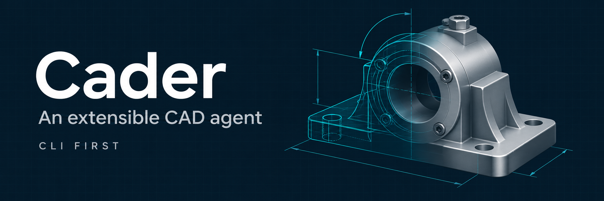

<p align="center">
  
</p>

<p align="center">
  <strong>English</strong> · <a href="README.zh-CN.md">简体中文</a>
</p>

<p align="center">
  <a href="https://github.com/codesknight/Cader/actions/workflows/ci.yml"></a>
  <a href="package.json"></a>
  <a href="LICENSE"></a>
</p>

<p align="center">
  An extensible CAD agent, built on DeepSeek Harness.<br>
  Plan with models. Act through tools. Verify with evidence.
</p>

<p align="center">
  <a href="#overview">Overview</a> ·
  <a href="#quick-start">Quick Start</a> ·
  <a href="#configuration">Configuration</a> ·
  <a href="#roadmap">Roadmap</a> ·
  <a href="#documentation">Documentation</a>
</p>

---

<a id="overview"></a>

## Overview

Cader is an extensible AI agent project for computer-aided design. It combines
[DeepSeek Harness](https://github.com/deepseek-ai/deepseek-harness) and Cordis with
CAD tools exposed through the Model Context Protocol (MCP).
[AutoCAD-MCP](https://github.com/codesknight/AutoCAD-MCP) is the first backend integration.

The strategy is **CLI First**: establish the agent foundation with DSH Headless,
evaluate a community TUI, then build Cader's own CLI. Web UI and CAD-embedded plugins
follow once the underlying services are stable.

> **Project status — M0 integration.** Model profiles, bounded delegation, and read-only
> AutoCAD integration have smoke-test evidence. Today's entry points are the `pnpm`
> commands below, including user tasks through read-only `exec`. An installable
> `cader` binary and community TUI integration remain planned. A controlled CAD scheduler
> now passes component fixtures; real draw–save–reopen awaits the managed MCP contract.

| Capability | Current implementation |
|---|---|
| Agent runtime | DSH default AgentLoop, Cordis, official model adapter and MCP client |
| Context assembly | Stable Static prompts plus dynamic Available context; explicit, role-scoped Skill catalog and on-demand references |
| Delegation | Main agent coordinates up to **5 concurrent subagents**; children return results without delegating |
| Model profiles | YAML profiles for main, text-review, and vision agents; credentials come from environment variables |
| CAD integration | Read-only Agent profile; separate program-controlled scheduler for a reviewed geometry fixture |
| Verification | Independent entity/file/reopen checks, image fact/graph gates, deterministic fixtures and Windows/Linux CI |

```text
CLI / scripts → Cader profile → DSH + Cordis → MCP → AutoCAD
                    │
                    ├── Static + Available context
                    ├── Main agent → bounded subagents → main decision
                    └── Policies, budgets, events, and verification
```

<a id="quick-start"></a>

## Quick Start

### 1. Prepare the environment

| Requirement | Version / purpose |
|---|---|
| Node.js | **24.9.0 or newer** |
| pnpm | **11.28.5**, managed with Corepack |
| Git | Clone and track the workspace |
| uv + Python | Optional Python MCP diagnostics; Python **3.11** is pinned in `cader-mcp/` |

The first smoke test needs **no API key and no AutoCAD installation**.

### 2. Install and run

Run from a terminal with Node.js and Corepack available:

```sh
git clone https://github.com/codesknight/Cader.git
cd Cader
corepack enable
corepack prepare pnpm@11.28.5 --activate
pnpm install --frozen-lockfile
pnpm run doctor
pnpm test
pnpm smoke
```

`pnpm run doctor` checks the Node runtime. `pnpm smoke` exercises actual DSH components
with deterministic tools and should report `ok: true` with six passing checks.
It saves configuration, events, verification results, and a summary under
`.cader/runs/<run_id>/`. This is a component fixture, not a real-model or CAD benchmark.

<details>
<summary><strong>Optional: Python MCP diagnostics</strong></summary>

Install [uv](https://docs.astral.sh/uv/) and run from the repository root:

```sh
uv sync --project cader-mcp --locked
uv run --project cader-mcp pytest -q cader-mcp/tests
uv run --project cader-mcp cader-mcp smoke
```

The Python smoke is an offline MCP protocol fixture. Real server connections use a
separate local JSON configuration; see the [configuration guide](docs/development/model-configuration.md).

</details>

### 3. Try a user task

With your root `.env` and local MCP configuration ready:

```sh
pnpm run cader --help
pnpm run cader exec "Inspect layers without editing the drawing" --mcp configs/mcp/AutoCAD.local.yaml
```

`exec` accepts your task; `live-smoke` remains a fixed diagnostic. Both retain the current
read-only policy. Real tasks call the paid provider. Failures now include a sanitized
`errorCode`, `source`, and actionable `hint`; `QUOTA` is a provider failure, not proof of MCP failure.
See [CLI usage and diagnostics](docs/development/cli.md) for direct JSON output and limits.

Results separate `run_status` from `task_status`. A completed read-only model task is
`unverified`; `exec --intent redraw` returns `blocked` without starting a model or MCP.
No model answer is treated as proof that a DWG was created.

### 4. Inspect the controlled CAD contract

```sh
pnpm run cader cad-contract
pnpm run cader cad-test --backend http --mcp configs/mcp/AutoCAD.http.local.yaml --plan benchmark/fixtures/managed-geometry.plan.json --output .cader/artifacts/geometry-001.dwg --authorize-write
```

The first command is offline. The second requires your own HTTP profile and compatible
managed-document/save/reopen endpoints; these are a **Cader-side proposal awaiting MCP support**.
It may create a new working drawing when capabilities pass. COM remains the default;
`--backend http` does not switch the server. Current local COM returns `HTTP_BACKEND_REQUIRED`.
Only the shipped, reviewed three-entity plan is allowed. Image-redraw plans stay blocked.
Unknown writes freeze the workspace: `cad-reconcile` only queries, never replays or unlocks.
See [the public contract](docs/contracts/managed-cad-v1.md) and [execution policy](docs/architecture/controlled-writes.md).

The unfrozen contract is now **draft revision 2**: writable working documents and read-only
verification documents have separate bindings; rollback checks use authoritative observed-event
revisions. Output directories bind at creation, and reconciliation distinguishes input/output
documents. See [the MCP alignment response](docs/contracts/mcp-alignment-response-2026-11-19.md)
and the [schema/example hash manifest](configs/contracts/cader-v1.manifest.json).

<a id="configuration"></a>

## Configuration

Editable agent assets live together under `configs/`:

```text
configs/
├── models/                  # MainAgent, SubAgent, VisionAgent YAML profiles
├── mcp/                     # DSH YAML and Python diagnostic JSON examples
├── cad/                     # Allowed operations and reviewed plan hashes
├── contracts/               # Versioned CAD/task/perception JSON schemas
├── prompts/static/          # Stable role and coordination instructions
├── skills/                  # Reviewed, on-demand skill content
└── runtime.yaml             # Registered profiles, concurrency, budgets, tools
```

The root `.env` provides credentials; `.cader/` stores private runtime artifacts.
[`configs/skills/catalog.yaml`](configs/skills/catalog.yaml) registers `cad-inspection` and
`cad-redraw-review`. CLI discovery and DSH loading use the same catalog. Adding a folder
alone does not register a capability or grant tool execution.

### CAD redraw assessment

```sh
pnpm run cader skills list
pnpm run cader skills show cad-redraw-review
pnpm run cader exec "Assess the reference, identify missing scale evidence, and propose verification steps" --skill cad-redraw-review --image benchmark/fixtures/vision-calibration.png
```

The first two commands need no key or CAD. The last calls your image-capable main model;
the bundled image is a synthetic attachment demo, not a drawing benchmark. Replace it with
your own workspace PNG/JPEG for reference review (up to 10 MiB / 40 million pixels).

This Cader-authored Skill assesses evidence and redraw readiness. It does **not generate DWG**,
execute scripts, or open write tools. It follows a review of
[AutoCAD Redraw Skills](https://github.com/pengxiaoan/autocad-dwg-redraw-skill);
the pinned upstream snapshot had no explicit license, so its files are not redistributed.
See the [research and integration analysis](docs/research/redraw-skill-integration-2026-11-19.md)
for the workflow mapping, code-review findings, and planned MCP execution/verifier layers.

Local image cases can also be checked with `pnpm image-test --manifest benchmark/image-cases.example.json`;
add `--live` for paid recognition tests against independent expected JSON. User images in
`tests/images/` stay local. [First real-image test results](docs/research/local-image-tests-2026-11-19.md)
separate input/recognition checks from the still-pending CAD drawing workflow.

For dense text, `exec --image <file> --crop x,y,width,height --rotate 90` and the scoped
`cader_view_image` tool use original-resolution regions. Events record source, view,
attachment and actual request-image hashes with coordinate mappings. `assessment-check`
compares structured facts and port connectivity with independent expectations. These gates
do not prove real-image recognition accuracy or DWG topology; see [perception evidence](docs/contracts/perception-v1.md).

### Connect your models and AutoCAD-MCP

1. Create `.env` from [`.env.example`](.env.example) **if it does not already exist**,
   then set `DEEPSEEK_API_KEY` locally. YAML references the variable name, never its value.
2. Review [`configs/models/`](configs/models/). Current profiles use **deepseek-flash**
   for main and vision agents, and **deepseek-v4-pro** for text review.
3. Copy [`AutoCAD.example.yaml`](configs/mcp/AutoCAD.example.yaml) to
   `configs/mcp/AutoCAD.local.yaml`. Set `command` to the separate AutoCAD-MCP Python
   executable and `cwd` to that backend's checkout.

```sh
pnpm models
pnpm live-smoke --mcp configs/mcp/AutoCAD.local.yaml
```

`pnpm models` validates configuration without calling a provider. `live-smoke` invokes
the paid model API and local CAD backend, checking read-only operations and delegated
results. Real AutoCAD execution requires Windows and a working backend installation.

For vision calibration, supply the image and independent expected result:

```sh
pnpm live-smoke --mcp configs/mcp/AutoCAD.local.yaml --image benchmark/fixtures/vision-calibration.png --expected-image benchmark/fixtures/vision-calibration.expected.json
```

The root `.env` and `*.local.yaml` / `*.local.json` under `configs/` are ignored by Git.
DSH YAML and Python diagnostic JSON use different schemas.
See the [model and MCP guide](docs/development/model-configuration.md) for full details.

<a id="roadmap"></a>

## Roadmap

| Stage | Focus | Status |
|---|---|---|
| Agent foundation | DSH, model profiles, Static / Available, read-only MCP smoke | Implemented; broader M0 validation continues |
| Headless + community TUI | Full Headless profile, session lifecycle, Windows TUI compatibility | Next / [TUI validation #9](https://github.com/codesknight/Cader/issues/9) |
| Cader CLI | Read-only `exec`, help and diagnostics available; packaging, event stream and sessions pending | Partial / [CLI foundation #10](https://github.com/codesknight/Cader/issues/10) |
| CAD workflow | Working copies, draw–save–reopen, independent verification, benchmarks | Planned / [CAD workflow #3](https://github.com/codesknight/Cader/issues/3) |
| Additional interfaces | Web UI and CAD-embedded plugins sharing the same services | Later |

See the [CLI First plan](docs/architecture/cli-first.md) for stage acceptance criteria.

<a id="documentation"></a>

## Documentation

| Resource | Contents |
|---|---|
| [Technical design v0.2](docs/designs/Cader_Technical_Design_v0.2.md) · [CLI design](docs/designs/Cader_CLI_Design.md) | Original proposals; planned APIs are not shipped features |
| [Architecture decisions](docs/adr/) | Harness selection, model roles, configuration layout, CLI First |
| [Model and MCP guide](docs/development/model-configuration.md) | Profiles, credentials, local MCP setup, live smoke |
| [Skill integration analysis](docs/research/redraw-skill-integration-2026-11-19.md) · [ADR 0004](docs/adr/0004-reviewed-skill-catalog-and-redraw-assessment.md) | Upstream research, Cader-owned assessment, registration and capability boundaries |
| [Development records](docs/development/README.md) | Requirements, logs, tests, bugs, and iteration history |
| [Live smoke evidence](docs/research/smoke-2026-11-19.md) | Real-model, read-only AutoCAD, and synthetic vision-calibration results |
| [Benchmark specification](benchmark/README.md) | G01–G10 scenarios; real-model benchmark scores are not yet published |

Detailed design and development notes are currently mostly in Chinese.
The cover is conceptual artwork, not an application screenshot or CAD test result.

## Contributing

Start with the [open issues](https://github.com/codesknight/Cader/issues) and
[development process](docs/development/process.md). Run `pnpm typecheck` and `pnpm test`
before submitting changes; add `pnpm smoke` for Harness changes. Keep credentials,
private drawings, and raw live-run artifacts out of commits.

## License

[MIT](LICENSE) · Copyright © 2026 codesknight
