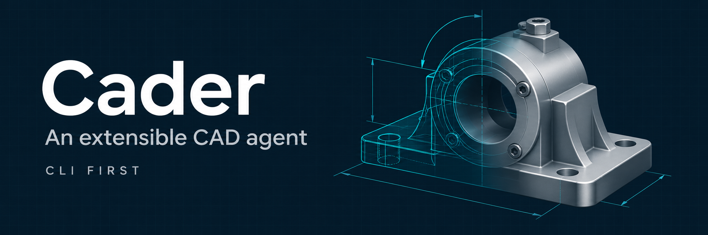

<p align="center">
  
</p>

<p align="center">
  <a href="README.md">English</a> · <strong>简体中文</strong>
</p>

<p align="center">
  <a href="https://github.com/codesknight/Cader/actions/workflows/ci.yml"></a>
  <a href="package.json"></a>
  <a href="LICENSE"></a>
</p>

<p align="center">
  基于 DeepSeek Harness，构建可扩展的 CAD 智能体。<br>
  以模型规划任务，以工具执行操作，以证据验证结果。
</p>

<p align="center">
  <a href="#overview">项目介绍</a> ·
  <a href="#quick-start">快速开始</a> ·
  <a href="#configuration">配置说明</a> ·
  <a href="#roadmap">开发路线</a> ·
  <a href="#documentation">文档索引</a>
</p>

---

<a id="overview"></a>

## 项目介绍

Cader 是面向计算机辅助设计的可扩展 AI Agent 项目，以
[DeepSeek Harness](https://github.com/deepseek-ai/deepseek-harness) 与 Cordis 为运行基础，
通过模型上下文协议（MCP）连接 CAD 工具。
[AutoCAD-MCP](https://github.com/codesknight/AutoCAD-MCP) 是首个后端集成。

项目采用 **CLI First** 策略：先复用 DSH Headless 建立基础 Agent、验证社区 TUI，
再逐步实现 Cader CLI。待底层服务稳定后，继续开发 Web UI 与 CAD 内嵌插件。

> **当前阶段：M0 集成。** 模型配置、受限子任务委派和 AutoCAD 只读集成已有 smoke 验证记录。
> 当前可用入口是下文的 `pnpm` 命令；独立 `cader` CLI、社区 TUI 接入及绘制—保存—重开闭环仍在规划中。

| 能力 | 当前实现 |
|---|---|
| Agent 运行时 | DSH 默认 AgentLoop、Cordis、官方模型适配器与 MCP 客户端 |
| 上下文组装 | 稳定的 Static 提示词，结合工具、Skill、模型及预算动态生成 Available |
| 子任务委派 | 主 Agent 最多协调 **5 个并行子 Agent**；子 Agent 返回结果，不继续委派 |
| 模型配置 | 主 Agent、文本审查和视觉子任务使用 YAML profile；凭据通过环境变量提供 |
| CAD 集成 | 已审查的 AutoCAD 只读工具；M0 profile 保持禁止写入 |
| 验证与记录 | 确定性 fixture、本地 smoke 记录，以及 Windows/Linux CI |

```text
CLI / 脚本 → Cader profile → DSH + Cordis → MCP → AutoCAD
                  │
                  ├── Static + Available 上下文
                  ├── 主 Agent → 受限子任务 → 主 Agent 统一决策
                  └── 策略、预算、事件与验证
```

<a id="quick-start"></a>

## 快速开始 · Quick Start

### 1. 准备环境

| 依赖 | 版本 / 用途 |
|---|---|
| Node.js | **24.9.0 及以上** |
| pnpm | **11.28.5**，通过 Corepack 管理 |
| Git | 获取代码与管理工作区 |
| uv + Python | 独立 Python MCP 诊断使用，可选；`cader-mcp/` 固定 Python **3.11** |

首次 smoke **不需要 API Key，也不需要安装 AutoCAD**。

### 2. 安装并运行

在已安装 Node.js 与 Corepack 的终端执行：

```sh
git clone https://github.com/codesknight/Cader.git
cd Cader
corepack enable
corepack prepare pnpm@11.28.5 --activate
pnpm install --frozen-lockfile
pnpm run doctor
pnpm test
pnpm smoke
```

`pnpm run doctor` 检查 Node 运行环境。`pnpm smoke` 使用确定性工具验证真实 DSH 组件，
预期返回 `ok: true`，六项检查通过。配置、事件、验证结果与摘要保存在
`.cader/runs/<run_id>/`。这是组件 fixture，不代表真实模型或 CAD 基准成绩。

<details>
<summary><strong>可选：Python MCP 诊断</strong></summary>

安装 [uv](https://docs.astral.sh/uv/)，在仓库根目录执行：

```sh
uv sync --project cader-mcp --locked
uv run --project cader-mcp pytest -q cader-mcp/tests
uv run --project cader-mcp cader-mcp smoke
```

Python smoke 是离线 MCP 协议 fixture。连接真实服务需另行配置本机 JSON 文件，
详见[配置指南](docs/development/model-configuration.md)。

</details>

<a id="configuration"></a>

## 配置说明

需要维护的 Agent 配置与资源统一放在 `configs/`：

```text
configs/
├── models/                  # 主 Agent、文本子 Agent、视觉子 Agent
├── mcp/                     # DSH YAML 与 Python 诊断 JSON 示例
├── prompts/static/          # 稳定的角色规则与统筹提示词
├── skills/                  # 已审查、按需加载的 Skill 内容
└── runtime.yaml             # 注册模型、并发、预算与工具范围
```

根 `.env` 提供凭据，`.cader/` 保存私有运行记录。
当前 Skill 加载器只开放已审查的 `cad-inspection`，添加文件不等于自动注册新能力。

### 连接模型与 AutoCAD-MCP

1. **仅在尚无 `.env` 时**，根据 [`.env.example`](.env.example) 创建文件，
   在本机填写 `DEEPSEEK_API_KEY`。YAML 只引用环境变量名，不保存密钥值。
2. 检查 [`configs/models/`](configs/models/) 中的 profile。当前主 Agent 与视觉子 Agent
   使用 **deepseek-flash**，文本审查使用 **deepseek-v4-pro**。
3. 将 [`AutoCAD.example.yaml`](configs/mcp/AutoCAD.example.yaml) 复制为
   `configs/mcp/AutoCAD.local.yaml`。`command` 指向独立 AutoCAD-MCP 环境的 Python，
   `cwd` 指向该后端的代码目录。

```sh
pnpm models
pnpm live-smoke --mcp configs/mcp/AutoCAD.local.yaml
```

`pnpm models` 只检查配置，不调用模型。`live-smoke` 会调用付费模型 API 和本机 CAD 后端，
验证只读操作及子任务返回。真实 AutoCAD 执行需要 Windows 与可用的后端环境。

验证视觉输入时，可附上仓库提供的校准图和独立期望结果：

```sh
pnpm live-smoke --mcp configs/mcp/AutoCAD.local.yaml --image benchmark/fixtures/vision-calibration.png --expected-image benchmark/fixtures/vision-calibration.expected.json
```

根 `.env` 以及 `configs/` 下的 `*.local.yaml`、`*.local.json` 已被 Git 忽略。
DSH YAML 与 Python 诊断 JSON 使用不同 schema，不能互换。
完整参数见[模型与 MCP 指南](docs/development/model-configuration.md)。

<a id="roadmap"></a>

## 开发路线

| 阶段 | 重点 | 状态 |
|---|---|---|
| Agent 基础 | DSH 集成、模型配置、Static / Available、MCP 只读 smoke | 已实现；M0 继续扩展验证 |
| Headless + 社区 TUI | 完整 Headless profile、会话生命周期、Windows TUI 兼容性 | 下一阶段 / [TUI 验证 #9](https://github.com/codesknight/Cader/issues/9) |
| Cader CLI | 可安装入口、帮助、诊断、`exec`、结构化事件与会话 | 规划中 / [CLI 基础 #10](https://github.com/codesknight/Cader/issues/10) |
| CAD 操作闭环 | 工作副本、绘制—保存—重开、独立验证与基准评测 | 规划中 / [CAD 闭环 #3](https://github.com/codesknight/Cader/issues/3) |
| 更多交互入口 | 共享底层服务的 Web UI 与 CAD 内嵌插件 | 后续阶段 |

各阶段验收条件见 [CLI First 实施规划](docs/architecture/cli-first.md)。

<a id="documentation"></a>

## 文档索引

| 资料 | 内容 |
|---|---|
| [技术设计 v0.2](docs/designs/Cader_Technical_Design_v0.2.md) · [CLI 设计](docs/designs/Cader_CLI_Design.md) | 原始设计稿；规划接口不等同于已实现功能 |
| [架构决策](docs/adr/) | Harness 选型、模型角色、配置目录与 CLI First |
| [模型与 MCP 指南](docs/development/model-configuration.md) | 模型 profile、凭据、本机 MCP 与真实 smoke |
| [开发过程记录](docs/development/README.md) | 需求、日志、测试、Bug 与迭代历史 |
| [真实 smoke 证据](docs/research/smoke-2026-11-19.md) | 真实模型、AutoCAD 只读及合成图视觉校准记录 |
| [评测规格](benchmark/README.md) | G01–G10 场景；尚未发布真实模型基准评分 |

详细设计与开发记录目前主要使用中文。
封面是概念插画，不是应用截图或 CAD 实测结果。

## 参与开发

从[开放的 Issues](https://github.com/codesknight/Cader/issues)和
[开发流程](docs/development/process.md)开始。提交前运行 `pnpm typecheck`、`pnpm test`；
涉及 Harness 时增加 `pnpm smoke`。密钥、私有图纸和原始真实运行记录不提交仓库。

## 开源协议

[MIT](LICENSE) · Copyright © 2026 codesknight
