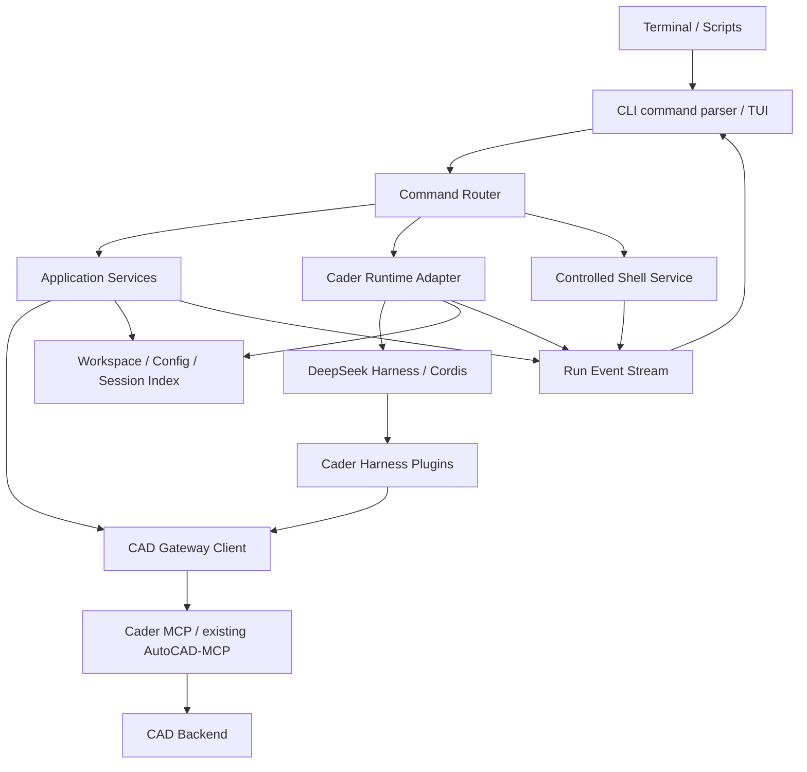
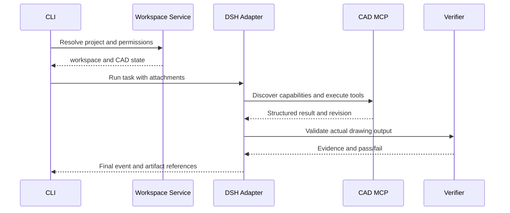

# Cader CLI 技术设计文档

> 版本：v0.1 · 2026-11-19 · 状态：设计稿 / 待实施
>
> 上位文档：`Cader_Technical_Design_v0.2.md`。本文件细化 CLI、TUI 与非交互执行接口；DeepSeek Harness 为已确定的 Agent Runtime。

## 1. 目标与边界

Cader CLI 是通用 CAD Agent 的主入口，既支持类似 Claude Code / Gemini CLI 的交互式工作台，也支持脚本、CI 和 Benchmark 的非交互执行。用户能够在任意工程目录启动 Cader，打开图纸、连接 CAD 软件、控制命令行、管理模型和插件，并通过自然语言完成设计任务。

核心原则：CLI First / Harness First / Web Later；确定性操作不经过 LLM；CLI、TUI、未来 Web 共享应用服务；CAD 修改统一经过 MCP、权限检查和工作区控制；复用 DeepSeek Harness（DSH）而不是重写其 Agent Loop。

General CAD 是基础能力；Electrical、Mechanical、Architectural、Electronic CAD 是可选扩展，电气学术研究独立开展，当前数据仅覆盖变电站一次接线图。Text2CAD、Draft2CAD、Image2CAD、CAD Understanding 和 Editing 通过同一任务入口与相应扩展实现，不为每个领域复制 CLI。首版不承诺全格式解析或工程安全认证。

## 2. 架构与职责



| 层 | 责任 | 不应负责 |
|---|---|---|
| CLI/TUI | 参数、输入、展示、退出码 | 直接调用 COM、实现 Agent Loop |
| Application Services | 项目、图纸、配置、命令编排、权限 | 界面渲染 |
| DSH adapter | Profile 装配、任务调用、取消、事件映射 | CAD 几何算法 |
| Cader plugins | CAD 上下文、路由、验证、遥测 | 复制上游通用服务 |
| CAD Gateway Client | 连接、能力发现、统一工具调用 | 假设所有软件支持同一操作 |
| Cader MCP / backend | 真实 CAD 读写、能力声明、文件保存 | CLI 交互 |

M0 直接接入现有 AutoCAD-MCP；后续 Cader MCP Gateway 统一通用工具和领域扩展。两者不同时向模型暴露重复的修改工具。CLI 的确定性 CAD 命令和 Agent 写操作共享同一权限策略及文档锁。

## 3. 技术选型

| 模块 | 方案 |
|---|---|
| Agent Runtime | DeepSeek Harness + 其配套 Cordis |
| CLI | TypeScript / Node.js，Commander.js（建议） |
| TUI | Ink + React（建议，先做简易 REPL 再加 TUI） |
| Schema | Zod + 跨语言 JSON Schema（建议） |
| 项目管理 | pnpm workspace，锁文件入库 |
| CAD MCP | 独立 Python 进程，uv；复用现有 AutoCAD-MCP |
| 测试 | Vitest、集成测试、Windows 实机 E2E（建议） |

DSH 版本、Node 版本和真实启动接口在 M0 从上游 package manifests 确定并锁定。先使用 DSH headless / SDK 作集成验证，优先采用该版本公开 SDK 或受支持的进程协议；若只能使用子进程，建立 adapter 并解析有文档的结构化事件，不解析面向人的终端文本。不得把下文 Cader 命令和类型误认为上游已经实现的 API。

## 4. 四种交互入口

| 输入 | 路由 | 例子 |
|---|---|---|
| CLI 子命令 | 确定性服务 | `cader cad status` |
| Slash 命令 | 同一个命令注册表 | `/status` |
| 自然语言 | DSH Agent Runtime | `绘制一个半径50的圆` |
| Shell 快捷命令 | 受控 Shell 服务 | `!dir`（PowerShell） |

`@path` 是显式附件引用，不是 Shell 展开；解析带引号路径并展示将发送给模型的文件。未知 slash 命令明确报错，不自动回退为自然语言。Shell 快捷命令不默认把输出送入模型上下文。CLI/TUI 共享 Command Registry，避免两个实现出现行为差异。

## 5. 命令规范

以下均为 Cader 计划接口，非 DSH 自带命令。P0 为 MVP；P1 为后续。帮助、版本、参数错误不应要求联网或模型密钥。

### 5.1 项目与工作区

| 命令 | 行为 | 优先级 |
|---|---|---|
| `cader [path]` | 启动交互，默认当前目录 | P0 |
| `cader init [path]` | 初始化项目配置，不覆盖现有文件 | P0 |
| `cader new <name>` | 创建目录及模板 | P1 |
| `cader open <path>` | 目录：进入交互工作区；图纸：连接后端并打开后进入交互 | P0 |
| `cader status` | 项目、模型、后端、活动图纸及运行状态 | P0 |
| `cader doctor` | 检查运行时、凭证存在性、MCP、CAD 可达性 | P0 |

CLI 是独立进程，不改变父 Shell 的当前目录；交互模式 `/cd` 仅切换 Cader workspace，并需要处理活动任务和未保存图纸。`open` 不等于 `cad launch`，后端未运行时提示用户或显式授权启动。

### 5.2 CAD 控制

| 命令 | 行为 | 优先级 |
|---|---|---|
| `cader cad connect [backend]` | 连接已配置后端并探测能力 | P0 |
| `cader cad status` | 连接、活动图纸、单位、revision | P0 |
| `cader cad open <file>` | 打开图纸，默认使用工作副本 | P0 |
| `cader cad save` | 保存指定工作副本 | P0 |
| `cader cad launch <backend>` | 启动受支持的 CAD 软件 | P1 |
| `cader cad export --format dxf --output <path>` | 导出到工作区 | P1 |
| `cader cad command -- <command>` | 原生命令执行，能力检测及审批 | P1 |
| `cader cad checkpoint` / `restore <id>` | 建立/恢复检查点 | P1 |

每次修改必须校验 workspaceId、documentId、revision/指纹和 operationId。不可确认写入结果时禁止盲目重试。不同 CLI 进程要通过 CAD 服务端协调文档锁，不能仅依靠进程内 mutex。短命 CLI 命令的连接状态以实际探测为准，不能将本地配置误当成持续连接；AutoCAD 进程与文档在命令退出后可以继续存在。

### 5.3 Agent 与模型

```powershell
cader exec "绘制一个100×200的矩形" --workspace .
cader exec "检查图纸" --file drawing.dwg --json
cader exec "重建草图" --image draft.png --domain general
cader exec "分析图纸" --model my-vlm --timeout 300
cader resume <session-id>
```

`exec` 为规范命令，兼容上位文档中的 `run` 作为别名。`--file`、`--image` 可重复；附件仅在工作区或显式授权路径内；`--timeout` 单位秒；`--json` 输出 JSONL 事件；`--model` 与 `--domain` 仅影响当前运行，不写持久配置。`--output` 指定产物目录；`--max-steps`、`--max-tokens` 为 P1 预算选项，只有底座可准确执行时才能声明支持。

| 命令 | 行为 | 优先级 |
|---|---|---|
| `cader model list` | 已配置 provider/model 与能力 | P0 |
| `cader model use <id>` | 设置项目默认模型 | P0 |
| `cader model status` | 当前模型、配置来源 | P0 |
| `cader model add` / `test <id>` | 配置及连接测试 | P1 |

不能以文本模型假装完成图像识别。发现模型或 MCP 图像传输不支持视觉时应返回明确错误，或提示使用原生 CAD 查询。

### 5.4 MCP、Skill、Domain、Plugin

| 命令 | 行为 | 优先级 |
|---|---|---|
| `cader mcp list` / `test <id>` | 列服务及连接测试 | P0 |
| `cader mcp tools <id>` | 发现工具与 schema | P0 |
| `cader mcp add <id>` | 配置 stdio/HTTP 服务 | P1 |
| `cader mcp enable/disable <id>` | 项目级启停 | P1 |
| `cader skill list` | 显示发现的技能 | P0 |
| `cader skill install <source>` | 经用户确认安装技能 | P1 |
| `cader skill enable/disable <id>` | 启用/禁用 | P1 |
| `cader domain list/use <id>` | 管理领域默认配置 | P1 |
| `cader plugin list/enable/disable <id>` | 管理 Harness 插件 | P1 |

`list/use` 表示相应独立子命令，不是字面含斜杠命令。外部插件是可信代码边界，安装、升级与启用必须显式确认，记录来源与版本；Skill 文本不具备提高权限的能力。

### 5.5 Session、Task、Benchmark

| 命令 | 行为 | 优先级 |
|---|---|---|
| `cader session list` | 项目会话索引 | P0 |
| `cader session resume <id>` | 恢复交互（`cader resume` 别名） | P0 |
| `cader session export <id>` | 导出脱敏事件 | P1 |
| `cader task list` | 查看运行记录 | P1 |
| `cader task cancel <id>` | 请求取消活动任务 | P1 |
| `cader task retry <id>` | 创建关联的新 run，重新校验文档 | P1 |
| `cader trace inspect <run-id>` | 查询结构化日志 | P1 |
| `cader bench run --suite general-smoke` | 执行评测套件 | P1 |
| `cader bench report` | 查看评测结果 | P1 |

跨进程 task cancel 需要常驻 supervisor/IPC；MVP 仅支持当前进程 Ctrl+C 取消，不能承诺跨进程取消。会话恢复不等于 CAD 状态恢复，也不保证继续未完成的写操作。

## 6. 交互式 TUI

```text
CADER  v0.1.0
Autonomous CAD Agent
Workspace : D:\CAD\demo
Harness   : DeepSeek Harness
Backend   : AutoCAD (connected)
Drawing   : example.dwg (working copy)
Model     : configured-vlm

> /status
  ...
> 绘制一个半径为50的圆
  [tool] general_create_circle ...
  [verify] circle geometry confirmed
> _
/help  /model  /mcp  /skills  /exit
```

| Slash 命令 | 作用 |
|---|---|
| `/help`, `/status`, `/exit` | 帮助、状态、退出 |
| `/open <path>`, `/cd <path>` | 打开图纸、切换工作区 |
| `/model [id]`, `/mcp`, `/skills`, `/domain` | 配置管理 |
| `/context`, `/compact` | 查看当前上下文、压缩（支持时） |
| `/clear` | 清空显示或开启新会话，明确区分，不删除历史 |
| `/resume <id>` | 切换会话 |
| `/permissions` | 查看与调整授权 |
| `/checkpoint`, `/undo` | 创建检查点、请求受控撤销 |

输入：多行粘贴、历史、Tab 补全（P1）；Esc 请求取消当前任务；Ctrl+C 第一次取消、第二次提示强制退出或退出（若有未知写入状态必须提示）。工具调用展示名称、结果摘要、错误与耗时，隐藏密钥，不展示或依赖模型私有推理。未保存图纸退出前确认；非交互模式不弹出提示，返回 NEEDS_INPUT 或失败。

## 7. 项目目录与配置

```text
my-project/
├── .cader/
│   ├── config.json
│   ├── sessions/
│   ├── runs/
│   └── checkpoints/
├── drawings/
├── references/
├── assets/
├── outputs/
└── AGENTS.md
```

`cader init` 默认仅创建缺失目录/配置、AGENTS.md 示例及忽略规则，不建立 Git 仓库、不启动 CAD、不安装插件。未初始化目录可只读运行；写任务要求显式工作区授权。配置示例（Cader 自有 schema，不是 DSH 配置）：

```json
{
  "schemaVersion": 1,
  "model": {"default": "my-vlm", "providers": {}},
  "cad": {"backend": "autocad", "endpointId": "autocad-local"},
  "mcp": {"servers": {}},
  "domain": "general",
  "skills": {"enabled": ["general-cad"]},
  "permissions": {"writeMode": "workspace-copy", "shell": "ask", "nativeCadCommand": "ask"},
  "outputDir": "outputs"
}
```

优先级：内置默认 < 用户级配置 < 项目配置 < 当前 CLI 参数；环境变量或安全存储提供凭证。权限不能由不可信项目文件放宽；显式授权单独记录。项目路径向上发现最近的 `.cader/config.json`，规范化真实路径，处理 Windows 盘符、空格、中文与 symlink/junction。用户级配置使用系统标准配置目录；项目配置写入采用临时文件替换，避免部分写入。运行数据、密钥、私有图纸默认不入 Git。会话索引只记录必要关联信息，DSH 会话原始数据由 adapter 按上游支持的存储机制管理。

## 8. 运行时接口与事件

复用上位设计的 `Task`、`RunResult`、`CaderRuntime`，以下仅为 CLI 所需的适配层增量，不是 DSH SDK 的真实签名。

```ts
interface CliRuntime extends CaderRuntime {
  events(runId: string): AsyncIterable<RunEvent>;
  resume(sessionId: string, instruction?: string, signal?: AbortSignal): Promise<RunResult>;
  dispose(): Promise<void>;
}
interface RunEvent {
  schemaVersion: 1;
  seq: number;
  timestamp: string;
  runId: string;
  sessionId?: string;
  type: string;
  payload: Record<string, unknown>;
}
```

实现时应先订阅事件或原子创建 run 与订阅句柄，防止丢失首条事件；若底座无可重放流，则用 Cader 事件日志提供 replay。`run.started`、`assistant.delta`、`tool.started`、`tool.completed`、`approval.required`、`verification.completed`、`run.finished` 为 Cader 规范事件名，映射真实 DSH 事件后才对外发布。每个 run 必须有且仅有一条终态记录；进程异常时恢复日志标记为中断，不假造结果。

### 8.1 执行流程



状态沿用 `created → running → verifying → succeeded / failed / needs_input / cancelled`；验证失败可在有限预算内回到 running。取消时停止新调用，并等待正在执行的 CAD 操作返回或标记 UNKNOWN_WRITE_OUTCOME；不声明已撤销。恢复前读取文档实际 revision。最终成功必须依据任务验收及实际产物；普通对话不要求产生 CAD 文件。

### 8.2 非交互输出

`--json` 时 stdout 只输出 UTF-8 JSONL，无 ANSI、banner、进度条。诊断 stderr；无 JSON 时正常人类可读日志。示例：

```jsonl
{"schemaVersion":1,"seq":1,"timestamp":"2026-11-19T00:00:00Z","runId":"r1","type":"run.started","payload":{}}
{"schemaVersion":1,"seq":2,"timestamp":"2026-11-19T00:00:01Z","runId":"r1","type":"run.finished","payload":{"status":"succeeded","artifacts":["outputs/demo.dxf"]}}
```

输出示例是协议草案，不代表已运行。退出码约定：0 成功；1 任务/验证失败；2 参数或配置错误；3 依赖或后端不可用；4 需要用户输入/审批；5 超时；6 写入状态未知；130 用户中断。JSON 终态与退出码必须一致，未知写入优先于普通取消。不得输出密钥、无授权完整工程内容或模型私有推理。

## 9. 安全与命令行控制

- 所有写入默认落在工作区副本，原始 DWG/DXF 保持不变；覆盖原文件另行审批。
- `!command` 是用户显式请求的受控 Shell，Agent 发起的 Shell 调用也必须走权限服务。Windows 默认使用配置的 PowerShell，其他系统使用配置 shell；程序化子进程优先 argv 数组，不拼接不可信输入。执行 cwd 绑定 workspace，限制环境变量继承、时间、输出长度和并发。明确这不是完整 OS 沙箱；必要时采用独立沙箱或低权限进程。
- CAD 原生命令属于高风险能力，不默认向模型开放；拒绝未声明能力、任意脚本及越权文件操作。连接本地服务默认使用 loopback 或 stdio，远程连接要求认证及加密。
- 非交互任务默认拒绝未预先授权的高风险操作，不因 CI 模式自动放宽权限。审批需绑定具体动作、参数及文档 revision；超时或状态变化后失效。
- `AGENTS.md`、Skill、图纸 OCR 文本以及 MCP 返回均不能覆盖系统权限。日志和轨迹设置容量、保留及脱敏规则。
- 检查点/撤销由 CAD 后端能力实现；不将 Cordis 插件卸载、Session 恢复或 Shell 取消视为 CAD 回滚。

## 10. 仓库结构

在上位文档目录上增量实现，不另建第二套 Harness。

```text
Cader/
├── apps/cli/
│   ├── src/
│   │   ├── index.ts
│   │   ├── commands/       # 参数与子命令
│   │   ├── router/         # 命令注册表与分派
│   │   ├── tui/            # REPL / Ink components
│   │   └── renderers/      # human / JSONL
│   ├── package.json
│   └── tests/
├── packages/
│   ├── contracts/          # Task, RunEvent, config schema
│   ├── core/               # project, workspace, policy, session services
│   ├── dsh-adapter/        # locked upstream runtime integration
│   ├── profile/            # Cader plugin assembly
│   └── plugins/            # CAD context/routing/verification/telemetry
├── cader-mcp/              # Python gateway and adapters
├── skills/
├── benchmark/
├── tests/{integration,e2e}/
└── docs/architecture/CLI_DESIGN.md
```

`apps/cli/package.json` 使用 `bin: {"cader": "./dist/index.js"}`，入口包含 Node shebang；构建后检查 Windows npm/pnpm shim。CLI 依赖 core、contracts、adapter，不反向依赖 TUI；未来 Web 使用 core 与同一 event schema。

## 11. 实施顺序与验收

| Issue | 交付 | 验收 |
|---|---|---|
| CLI-001 | 锁定 DSH、Node、pnpm，最小调用 | 保存版本与可复现命令，真实模型/API smoke 成功 |
| CLI-002 | CLI skeleton / help / version | 无网络、无 API key 可运行，参数错误退出 2 |
| CLI-003 | init / open / workspace / config | 重复 init 不覆盖；中文与空格路径通过 |
| CLI-004 | doctor / status / MCP discovery | 后端离线、权限失败、未知工具正确报告 |
| CLI-005 | DSH adapter / exec / JSONL | 真实任务流式执行；终态和退出码一致 |
| CLI-006 | CAD connect/open/save | 实际图纸工作副本可读写；原文件哈希不变 |
| CLI-007 | REPL / slash router | 确定性命令不触发模型调用；同一服务复用 |
| CLI-008 | model / skills / session resume | 配置切换有效；恢复前校验图纸身份 |
| CLI-009 | Shell / approvals / cancel | 非交互拒绝未授权操作；取消无虚假成功 |
| CLI-010 | Windows E2E / docs | 从干净环境完成 init→open→exec→save→verify |
| CLI-011 (P1) | Ink TUI、补全、插件管理 | 不影响 headless；共享事件与命令注册表 |
| CLI-012 (P1) | bench / checkpoints / supervisor | 支持评测和明确的跨进程任务控制 |

### 11.1 MVP 测试矩阵

| 测试场景 | 预期 |
|---|---|
| `cader --help` / `--version` | 无模型凭证也可用 |
| 同目录连续 `init` 两次 | 用户配置不被覆盖 |
| 打开含中文与空格的 DWG | 路径正确，工作副本创建 |
| CAD 不在线 / 不支持操作 | 明确错误，不假装连接 |
| 绘制圆、矩形、查询实体 | 从实际产物独立检查坐标、尺寸、数量 |
| 删除原始图纸或越界路径 | 受阻并记录权限错误 |
| 非交互遇到审批 | 退出 4，不无限等待 |
| 模型错误、MCP 超时 | 有界失败；未知写入不重试 |
| Ctrl+C、会话恢复、外部编辑 | 取消状态诚实；恢复前校验 revision |
| JSONL 输出 | 每行可解析、终态唯一、无凭证泄漏 |
| 图片输入 + VLM / 非视觉模型 | 真实图像传递或明确不支持 |
| 两个进程同时修改同一图纸 | 服务端串行化或拒绝冲突 |

M0 在 Windows AutoCAD 实机及无 GUI 的 mock backend 上分别测试。Mock 测试不能替代真实 CAD 验收。Benchmark 不依赖电气研究数据，先使用通用几何、图纸查询及编辑任务。

## 12. 第一条用户旅程（目标效果）

```powershell
cd D:\CAD\demo
cader init
cader doctor
cader mcp test autocad
cader open .\drawings\demo.dwg
```

进入交互后执行 `/status`，输入“在原点绘制半径50的圆，保存到工作副本，并检查半径”，然后 `/exit`。同一任务也应该可以用 `cader exec` 自动化执行。验收证据包括命令日志、实际保存的图纸、独立几何校验结果、原文件哈希及退出码。

## 13. 参考与待确认事项

- DeepSeek Harness：https://github.com/deepseek-ai/deepseek-harness
- Gemini CLI：https://github.com/google-gemini/gemini-cli （交互与命令设计参考）
- AutoCAD-MCP：https://github.com/codesknight/AutoCAD-MCP
- Ink：https://github.com/vadimdemedes/ink
- Commander.js：https://github.com/tj/commander.js

已确定：DSH 底座、通用 CAD Agent 定位、MCP 与领域插件解耦。建议而未锁定：Commander、Ink、Zod、事件及退出码细节、项目 JSON 配置。上位文档与本设计的命令差异通过 `run` / `exec` 兼容别名解决；后续 ADR 记录最终规范。本文未执行 DSH 集成或 AutoCAD 实机测试，所有 Cader 命令均为目标设计；M0 必须查验锁定版本的 SDK、事件协议、取消和恢复能力、Windows 兼容性、MCP 多模态传输及真实绘图接口。若不支持某功能，明确降级或推迟，不编造上游接口。
