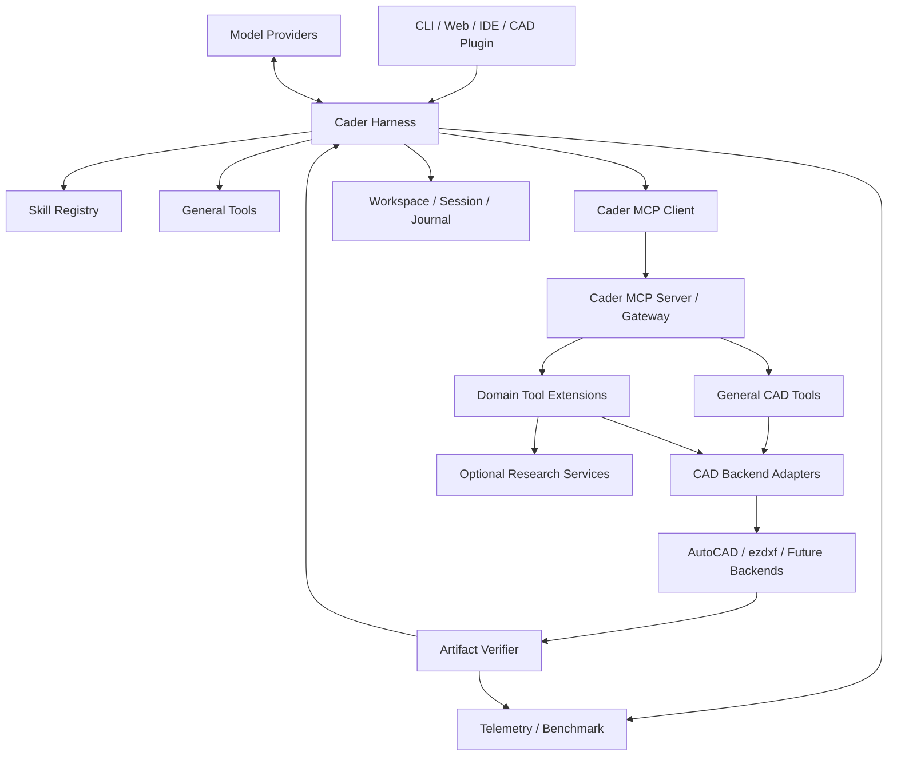

# Cader 开发指南

> Cader — An extensible AI agent for computer-aided design.
>
> 文档版本：v0.1 · 2026-11-18 · 状态：架构提案 / 项目初始化指南

## 1. 项目定位

Cader 是一个面向通用 CAD 场景的自主 AI Agent 平台。通过可替换的模型、可持续优化的 Agent Harness、统一的 CAD MCP、领域 Skill 和通用工具，完成图纸理解、生成、编辑、验证及交付等任务。

核心研发对象是 **CAD Agent Harness**，而非重新实现 CAD 几何内核，亦非堆积 MCP 工具。初期以 AutoCAD 为真实执行环境，优先复用已有 [AutoCAD-MCP](https://github.com/codesknight/AutoCAD-MCP)，逐步接入其他 CAD 软件。

### 1.1 领域边界

```text
Cader
├── Electrical CAD       # 首个专业扩展；当前研究数据仅覆盖变电站一次接线图
├── Mechanical CAD       # 未来扩展
├── Architectural CAD    # 未来扩展
├── Electronic CAD       # 未来扩展
└── General CAD          # 通用绘图、查询、编辑及文件能力
```

领域划分表示能力分类，不代表需要分别构建五个 Agent。General CAD 同时为其他领域提供基础能力。

电气图纸识别、检测、拓扑恢复、VLM 训练等学术研究独立开展，Cader 不负责维护研究数据集或训练模型。研究成果通过可选的领域扩展、模型推理接口、MCP 服务或 Skill 接入 Cader。研究模块不可用时，通用 Cader 仍应正常运行。

### 1.2 目标能力与非目标

| 能力 | 输入 | 输出 | 首版边界 |
|---|---|---|---|
| CAD Understanding | DWG/DXF、图像、PDF | 结构化信息、问答 | 优先原生 CAD 查询；图像能力按插件声明 |
| Text2CAD | 自然语言 | 可编辑图纸 | 基础二维绘图及简单组合 |
| Draft2CAD | 手绘草图 | 规范化图纸 | 可选实验扩展 |
| Image2CAD | 扫描图、截图 | 可编辑重建图纸 | 可选实验扩展，不承诺精确复刻 |
| CAD Editing | 图纸、修改需求 | 修改后的图纸 | 基础实体及图层编辑 |
| CAD Verification | 图纸、约束 | 检查报告 | 文件、实体、几何和回归检查 |

首版不做：自研大模型训练框架、通用几何求解内核、完整多智能体平台、所有 CAD 软件适配、生产级电气设计认证。不得将研究数据的覆盖范围表述为已支持全部电气领域。

## 2. 设计原则

1. Agent First：以真实任务完成率和工程产物为目标。
2. Harness Driven：框架可替换，领域优化有独立接口与实验记录。
3. Model Agnostic：模型选择由配置决定，支持能力探测和多模态差异。
4. CAD Agnostic：能力接口与软件后端解耦；不强行统一所有 CAD 内核语义。
5. Extension First：领域能力独立注册、启停、升级，不修改核心 Agent Loop。
6. Verification Driven：从真实产物读取状态，不以模型自述判断成功。
7. Safety by Default：默认只读或工作区副本写入，高风险操作审批，记录可追溯。

## 3. 总体架构



Cader MCP 是可独立部署的逻辑工具入口，可以由多个进程实现。领域扩展同时能够贡献 MCP 工具、Skill、资源、验证器或后端适配器；并非所有能力都必须通过 MCP RPC。Skill 与 Harness 不应从属于 MCP Server。

| 层 | 职责 | 不负责 |
|---|---|---|
| Harness | 模型循环、上下文、路由、生命周期、审批、恢复 | 具体 CAD API 细节 |
| MCP Gateway | 注册、发现、命名空间、权限、参数校验、调用分发 | 自主规划与模型推理 |
| Domain Extension | 专业工具、知识、资源、验证规则 | 强制修改核心循环 |
| Backend Adapter | 软件 API、文档状态、实际读写 | 领域推理 |
| Skill | 指令、SOP、参考资料、工具使用策略 | 强制安全保障 |
| Verifier | 独立验证工程状态与产物 | 为 Agent 的文本承诺背书 |

## 4. 技术选型（待 ADR 确认）

| 模块 | 建议 |
|---|---|
| 核心语言 | Python 3.11；对现有 AutoCAD-MCP 允许独立 Python 环境 |
| 包管理 | uv + pyproject.toml + lockfile |
| Harness 首选候选 | [Deep Agents](https://github.com/langchain-ai/deepagents) |
| 对照候选 | [OpenHands SDK](https://github.com/OpenHands/software-agent-sdk)、[Pi](https://github.com/earendil-works/pi) |
| 协议 | MCP 标准 SDK；本地 stdio / 远程 Streamable HTTP，能力依版本核实 |
| Schema | Pydantic / JSON Schema |
| CLI | Typer 或 argparse（首版选其一） |
| 持久化 | JSONL 运行日志 + 本地 SQLite（需要索引时引入） |
| 测试 | pytest；Windows 真实 AutoCAD 集成测试与跨平台单元测试分离 |
| 后端 | 现有 AutoCAD-MCP；后续按需求引入 ezdxf、FreeCAD 等 |

### 4.1 Harness 选型实验

不默认 Fork 整个 Coding Agent。先通过 SDK、Middleware、Hooks、Adapter 实现；仅当扩展点不足且实验确认收益时维护最小补丁或 Fork。

选型门槛：许可证允许预期的分发模式；可接入目标模型及 MCP；可记录每轮事件；支持工具错误反馈、预算与终止；具备自定义上下文、审批及状态恢复所需扩展点，或者可低成本补足。

用同一模型、同一工具集、同一份 10 个 CAD smoke tasks、相同预算测试候选框架。记录成功率、失败类型、P50/P95 耗时、Token、工具调用次数、扩展改动量。每个任务建议至少重复 3 次；小样本仅用于工程选型，不宣称统计显著。先决定一个 Python 底座，其他框架作为设计对照。

输出 `docs/adr/0001-harness-selection.md`，记录候选版本、commit、许可证、测试证据和决策。以上项目能力未在本指南中实测，安装命令与兼容性以锁定版本为准。

## 5. 仓库结构

建议初期单仓库、模块化开发；AutoCAD-MCP 保持独立仓库，通过标准协议集成。

```text
Cader/
├── README.md
├── AGENTS.md                     # 开发 Agent 的仓库约束
├── pyproject.toml
├── uv.lock
├── .gitignore
├── configs/
│   ├── cader.example.toml
│   └── mcp.example.json
├── src/cader/
│   ├── cli.py
│   ├── config.py
│   ├── contracts/               # 通用任务、工具、状态、扩展契约
│   ├── agent/                   # Agent 装配与任务生命周期
│   ├── harness/                 # 底座适配及 CAD 专属策略
│   │   ├── adapters/
│   │   ├── context/
│   │   ├── routing/
│   │   ├── policies/
│   │   └── recovery/
│   ├── models/
│   ├── mcp/
│   │   ├── client/
│   │   ├── server/
│   │   └── registry/
│   ├── tools/                   # 文件、搜索、受限执行等
│   ├── skills/                  # Skill 加载器
│   ├── extensions/              # 插件生命周期及发现
│   ├── backends/                # 后端接口与协议适配
│   ├── workspace/
│   ├── verifier/
│   └── telemetry/
├── extensions/
│   ├── general/
│   ├── electrical/              # 可选适配层，不包含学术训练工程
│   ├── mechanical/              # 后续按需创建
│   ├── architectural/
│   └── electronic/
├── skills/                      # 通用 Skill 资源
├── benchmark/
│   ├── tasks/general/
│   ├── fixtures/
│   ├── evaluators/
│   └── runner/
├── experiments/
├── tests/{unit,integration,e2e}/
└── docs/{adr,architecture,development}/
```

目录是目标结构，不要求初始化时创建空占位模块。优先实现一条可运行的纵向链路。生成产物放入被忽略的 `.cader/runs/`；私有图纸、密钥、模型缓存不提交公共仓库。

## 6. 核心契约

以下为建议的逻辑接口，不是已实现 API。优先稳定边界，而非过早建立复杂继承树。

```python
from typing import Any, Protocol
from dataclasses import dataclass, field

@dataclass
class Task:
    id: str
    instruction: str
    workspace_id: str
    domain: str = "general"

@dataclass
class ToolResult:
    ok: bool
    data: dict[str, Any] = field(default_factory=dict)
    artifacts: list[str] = field(default_factory=list)
    error_code: str | None = None
    retryable: bool = False

class HarnessAdapter(Protocol):
    async def run(self, task: Task) -> ToolResult: ...

class CADBackend(Protocol):
    async def capabilities(self) -> set[str]: ...
    async def invoke(self, operation: str, arguments: dict[str, Any]) -> ToolResult: ...

class Verifier(Protocol):
    async def verify(self, task: Task, artifact: str) -> ToolResult: ...
```

任务状态：`created -> running -> verifying -> succeeded | failed | needs_input | cancelled`。允许在有限预算内由 verifying 返回 running 修复产物；恢复时重新读取环境，不盲目重放写操作。

错误码建议：`UNSUPPORTED_CAPABILITY`、`INVALID_ARGUMENT`、`DOCUMENT_CHANGED`、`CAD_BUSY`、`TIMEOUT`、`PERMISSION_DENIED`、`VERIFICATION_FAILED`、`UNKNOWN_WRITE_OUTCOME`。最后一种错误必须先对账，不允许自动重试造成重复实体。

## 7. Cader MCP 设计

### 7.1 通用工具入口

```text
Cader MCP
├── general_*          # CAD 通用操作
├── electrical_*       # 可选电气专业工具
├── mechanical_*       # 未来
├── architectural_*    # 未来
├── electronic_*       # 未来
└── backend adapters  # AutoCAD / ezdxf / others
```

名称使用 ASCII 下划线前缀，避免后端或客户端对特殊字符的限制。实际工具名由注册表管理，记录来源、输入输出 schema、读写属性和所需 capability。禁止静默覆盖同名工具。

| 工具（计划） | 功能 | 类型 |
|---|---|---|
| general_get_capabilities | 后端能力发现 | 只读 |
| general_get_document | 当前图纸及单位、版本 | 只读 |
| general_list_entities | 分页或按区域查询 | 只读 |
| general_inspect_entity | 实体属性与引用 | 只读 |
| general_render_view | 受支持时生成预览 | 只读 |
| general_create_line | 绘制线段 | 写入 |
| general_create_circle | 绘制圆 | 写入 |
| general_create_layer | 新建图层 | 写入 |
| general_update_entity | 修改受支持属性 | 写入 |
| general_delete_entity | 删除指定实体 | 高风险写入 |
| general_save_as | 工作区内另存 | 写入 |
| general_apply_plan | 批量执行结构化操作 | 写入，后续实现 |

针对不同后端只暴露真实支持的工具。不要声称 ezdxf 原生支持 DWG 编辑，也不要将 COM 与 HTTP 当作互斥方案：COM 是 AutoCAD 执行接口，MCP stdio/HTTP 是传输方式。

### 7.2 后端与状态一致性

AutoCAD 的 COM 调用由适配器负责线程/应用实例管理、文档绑定、繁忙状态、异常规范化；同一文档写操作应串行化。首版不要自动创建多个 AutoCAD 实例。记下 document_id、revision 或等价状态指纹，避免误编辑用户当前打开的其他图纸。

Gateway 转发到已有 MCP 时，明确配置工作区和远端访问权限，不允许任意路径或任意命令透传。需要网络部署时增加认证、TLS、限流和审计，默认仅本地。

### 7.3 扩展方式

优先静态注册或可信本地插件，之后再支持 Python entry points。外部 MCP 通过显式配置接入。不要默认安装第三方仓库或执行其脚本。

```toml
# extensions/electrical/extension.toml（提案）
id = "electrical"
version = "0.1.0"
api_version = "1"
enabled = false
skills = ["skills/"]
required_capabilities = ["document.read"]
```

扩展可以提供 `register_tools`、`register_skills`、`register_verifiers`、`register_resources` 等入口。加载失败应隔离并记录诊断，不阻塞通用核心。不得用插件声明替代运行时权限校验。

## 8. Harness Engineering

默认循环：

```text
用户需求 -> 加载工作区及能力 -> 选择 Skill / 工具
    -> 模型规划与工具调用 -> 获取结构化观察 -> 检查任务状态
    -> 独立验证 -> 有限修正 -> 输出产物或明确失败原因
```

首版仅实现基础 loop 适配、日志、工具路由、预算、工作区与验证。后续按失败轨迹逐个优化：

| 模块 | CAD 定向优化 | 验证方式 |
|---|---|---|
| Observation | 图纸摘要、区域查询、实体详情、视觉预览 | 查询准确率、响应体积 |
| Context | 保留单位、坐标系、设计约束、实体引用；按需读取大图 | 长任务成功率、Token |
| Routing | 基础工具常驻，领域工具按需加载 | 误调用率、工具 schema Token |
| Planning | 显式依赖与批量计划；不强制所有任务先生成 IR | 执行成功率、调用次数 |
| Recovery | 检查点、操作日志、写入对账 | 故障恢复率、重复写入率 |
| Verification | 从最终文件或实际文档重新获取证据 | 假成功率、修复收益 |
| Memory | 项目参数、决策、可追溯工程状态 | 多轮编辑性能 |
| Subagent | 经验证后再引入领域专家路由 | 相比单 Agent 的实际收益 |

预算须可配置：最大模型轮数、最大工具调用、超时、最大修复次数、Token/费用（适用时）。触顶后返回部分产物和明确状态，不宣称成功。

CAD-IR 采用可选、分层策略：通用实体表示支持基础查询与编辑；Electrical/Mechanical 等领域自行定义专业语义。CADPlan 表达操作序列，两者不等价。保留原生 CAD 特性和引用，避免有损转换被当成真实图纸。

## 9. Skill 与通用工具

Skill 采用 `SKILL.md` + references/examples/scripts（按需）格式；内容按任务动态加载。Skill 不拥有安全权限，脚本必须经执行策略审批。

```markdown
---
name: cad-drawing
description: Create and edit basic 2D CAD drawings.
---
# Workflow
1. Inspect backend capabilities and document units.
2. Identify geometry and constraints.
3. Draw within the active workspace copy.
4. Verify saved artifact and report uncertainties.
```

首批 Skill：`cad-core`、`cad-inspection`、`cad-drawing`、`cad-editing`、`cad-verification`。专业 Skill 由领域扩展贡献。文件、搜索、图像、Python/Shell 等通用工具通过 Harness 接入并受工作区约束；不必为了统一而全部封装成 MCP。

## 10. 电气研究接入边界


当前只将变电站一次接线图作为首个专业验证场景；电气扩展应明确其能力声明、支持的设备类别、数据覆盖、置信度和无法识别项。研究接口可接收图像/图纸引用，输出版本化设备、连接、文字、几何及证据来源；具体 schema 由研究项目独立定义，Cader 通过适配层消费。

不将专用算法、训练代码、私有标注及数据集硬编码进核心。研究未完成时可用 mock fixture 验证插件接口，但不得将 mock 表现标作实际识别性能。电气工程图纸的施工及安全合规需专业审核。

## 11. 工作区、安全与产物

每次任务创建独立 run 目录：

```text
.cader/runs/<run_id>/
├── task.json
├── config.snapshot.json     # 脱敏
├── input/                  # 不可覆盖的原始输入副本
├── output/                 # CAD 产物与预览
├── events.jsonl
├── verification.json
└── summary.md
```

必须防止路径穿越、符号链接越界、任意脚本执行、误删文件及敏感信息泄漏。默认修改工作副本，覆盖原文件、批量删除及外部执行要求显式授权。图纸文字、网页、外部 Skill 和 MCP 输出均视为不可信数据，不能覆盖核心安全策略。日志不得保存 API key，记录模型和工具的可见事件、错误及状态；不要求采集模型隐藏推理。

当后端不支持原生事务时，采用工作副本和保存检查点，不承诺原子回滚。遇到超时、断线或部分写入，必须重新查询实际状态。

## 12. Cader-Bench

首版建立 10 个可自动验证的通用任务，后扩展至 30 个以上。不要依赖电气学术数据才能运行基础评测。

| ID | 任务 | 验证 |
|---|---|---|
| G01 | 创建图层 | 名称及属性 |
| G02 | 绘制指定线段 | 端点及容差 |
| G03 | 创建指定圆 | 圆心及半径 |
| G04 | 绘制闭合矩形 | 闭合、宽高 |
| G05 | 查询实体数量 | 对照 fixture |
| G06 | 按图层筛选 | 集合匹配 |
| G07 | 移动指定实体 | 坐标差值、无关实体不变 |
| G08 | 删除指定对象 | 目标不存在、无关实体不变 |
| G09 | 保存图纸 | 文件可重新打开 |
| G10 | 失败恢复 | 注入可恢复异常、核对无重复写入 |

任务使用 `task.json`、初始图纸、独立 verifier 与预期约束。Verifier 从实际保存产物或可信 CAD 状态提取证据；参考答案不必像素相同，允许几何等价。测试答案与评分逻辑尽可能不暴露给受测 Agent。

核心指标：任务完成率 = 通过任务/有效任务（无效环境任务单列）；假成功率 = 自报成功但未通过验证/自报成功任务；另记录 Token、耗时、调用次数、异常率和恢复率。报告同时公布基础设施失败与重试策略，防止筛掉失败场次造成偏差。

每次比较固定模型版本、提示词、后端、输入、预算、评分规则；记录 Git commit、配置哈希、随机种子（可用时）与全部试验。保留独立测试集，避免专门为评测题硬编码策略。

## 13. 项目初始化

以下为 Windows PowerShell 或跨平台终端的建议操作。需本机已安装 Git、uv 及 Python 下载所需网络；AutoCAD 真实集成需已有合法可用环境。以下命令是初始化方案，尚未在你的机器执行。

```powershell
mkdir Cader
cd Cader
git init -b main
uv init --package --name cader --python 3.11
uv add pydantic "mcp" typer
uv add --dev pytest ruff
uv run pytest --version
uv run python -c "import cader; print('Cader initialized')"
```

Harness 选型后再安装锁定版本的框架包，避免在初始化时引入所有候选依赖。先创建 `configs/`、`docs/adr/`、`tests/`、`benchmark/`，将本文放入 `docs/development/guide.md`。初始化锁文件、README、AGENTS.md 和 `.gitignore`。

```gitignore
.env
.env.*
!.env.example
.venv/
__pycache__/
.pytest_cache/
.ruff_cache/
.cader/
configs/local.*
```

示例 MCP 配置（Cader 内部拟定 schema；URL 需要替换为实际服务端点）：

```json
{
  "servers": {
    "autocad": {
      "transport": "streamable_http",
      "url": "http://127.0.0.1:8000/mcp",
      "enabled": true
    }
  }
}
```

也可配置 stdio、command、args；采用哪种取决于现有 AutoCAD-MCP 服务实际支持的协议和启动方式。不要把示例 URL 当作已验证接口。

建议 CLI 契约（待开发）：

```bash
cader doctor                       # 环境、模型、MCP 连接与能力诊断
cader mcp list                     # 服务及工具发现
cader run --workspace ./demo "Draw a circle of radius 10"
cader inspect --run-id <run_id>
cader bench --suite general-smoke
```

首个纵向链路必须真正运行：模型 -> Harness -> Cader MCP -> AutoCAD-MCP -> 实际 CAD 绘制 -> 保存 -> 独立检查 -> 输出结果。先做直连对照，再接入 Gateway，验证代理层不改变工具语义。

新建 GitHub 空仓库后（不要自动覆盖已有远端）：

```powershell
git add .
git commit -m "chore: initialize Cader project"
git remote add origin https://github.com/codesknight/Cader.git
git push -u origin main
```

远端地址是假设的目标地址，需确认仓库实际归属与存在。公开前选择许可证并检查上游依赖许可、CAD 软件许可和图纸分发权限。

## 14. 开发路线与验收

时间采用相对阶段而非承诺工期；以验收门槛进入下一阶段。

| 阶段 | 交付 | 验收条件 |
|---|---|---|
| M0 初始化与选型 | 仓库、ADR、框架 spike、连接诊断 | 锁定一个底座；可发现并实际调用现有 CAD 工具 |
| M1 Cader MVP | CLI、模型适配、基础 MCP、工作区、日志 | 图纸读取、绘制、保存真实闭环；错误诚实返回 |
| M2 扩展化 | 通用 MCP Gateway、插件注册、Skill loader | 单独启动 MCP；启停插件无需修改核心；mock 扩展隔离测试 |
| M3 评测 | 10 个通用任务、独立 verifier、runner | 评测可复现，基线和失败轨迹完整；不依赖研究服务 |
| M4 Harness 优化 | 动态路由、结构化状态、验证反馈、恢复 | 与基线配对对照，不降低关键安全或正确性指标 |
| M5 专业扩展 | Electrical 可选接入及领域测试 | 仅对已声明的一次接线图能力验收；研究未就绪不阻塞主线 |
| M6 产品扩展 | Web、多后端、其他领域 | 每项由实际需求和评测决定，不一次性全做 |

### 首批 GitHub Issues（建议）

- [ ] CADER-001：初始化包、CI、lint、pytest、README、AGENTS.md。
- [ ] CADER-002：定义 Task/ToolResult/Capability 与错误码。
- [ ] CADER-003：AutoCAD-MCP smoke client 与连接诊断。
- [ ] CADER-004：实现候选 Harness spike，记录选型 ADR。
- [ ] CADER-005：最小 Agent Loop 和模型配置。
- [ ] CADER-006：工作副本、权限、事件日志、执行预算。
- [ ] CADER-007：完成绘图、保存、真实产物独立验证。
- [ ] CADER-008：通用 MCP 工具注册与后端分发。
- [ ] CADER-009：Skill loader + 通用绘图 Skill。
- [ ] CADER-010：10 个任务的 Benchmark runner、报告与基线。
- [ ] CADER-011：插件加载、禁用和故障隔离测试。
- [ ] CADER-012：基于失败轨迹选择第一个 Harness 优化实验。
- [ ] CADER-013：Electrical 插件接口及 mock contract test（非学术研究实现）。

优先顺序：001 → 002/003 → 004 → 005/006 → 007 → 008/009/010；011 与 013 可独立推进，012 依赖基线。

## 15. 研发规范与 Definition of Done

每个 PR 说明任务、设计动机、边界、测试与兼容性；核心接口改变须记录 ADR。CI 至少运行 lint、单测及 fake backend contract tests；真实 AutoCAD 测试在专用 Windows 环境运行。默认不把 GUI 集成测试失败静默视为通过。

完成标准：功能真实可运行；有最少一个正常测试和一个失败测试；错误与日志清晰；配置和文档可复现；不泄漏秘密、不破坏原始图纸；新增 Harness 策略有基线对照或明确的后续验证计划。

### 推荐参考入口

- [Model Context Protocol](https://modelcontextprotocol.io/) — 协议及传输规范。
- [Agent Skills](https://agentskills.io/) — 技能封装规范。
- [Deep Agents](https://github.com/langchain-ai/deepagents) — Harness 候选。
- [OpenHands SDK](https://github.com/OpenHands/software-agent-sdk) — 执行与事件体系参考。
- [Pi](https://github.com/earendil-works/pi) — 轻量执行循环与扩展设计参考。
- [AutoCAD-MCP](https://github.com/codesknight/AutoCAD-MCP) — 已有项目、首个运行环境接入。

以上为研发参考入口，未在本文中重新核实最新版本、许可证或实际接口。框架、版本、目录和工具名称均为建议，非已完成实现。本文不会创建远程仓库或修改现有 AutoCAD-MCP。

## 16. 项目北极星

Cader = 可替换模型 + 持续优化的 CAD Harness + 统一工具与领域扩展 + 真实 CAD 环境。

以通用能力为核心，以实际工程任务驱动 Harness 优化，以独立评测衡量收益。电气学术研究是首个可接入的专业方向，不是整个项目的范围或研发前置依赖。
