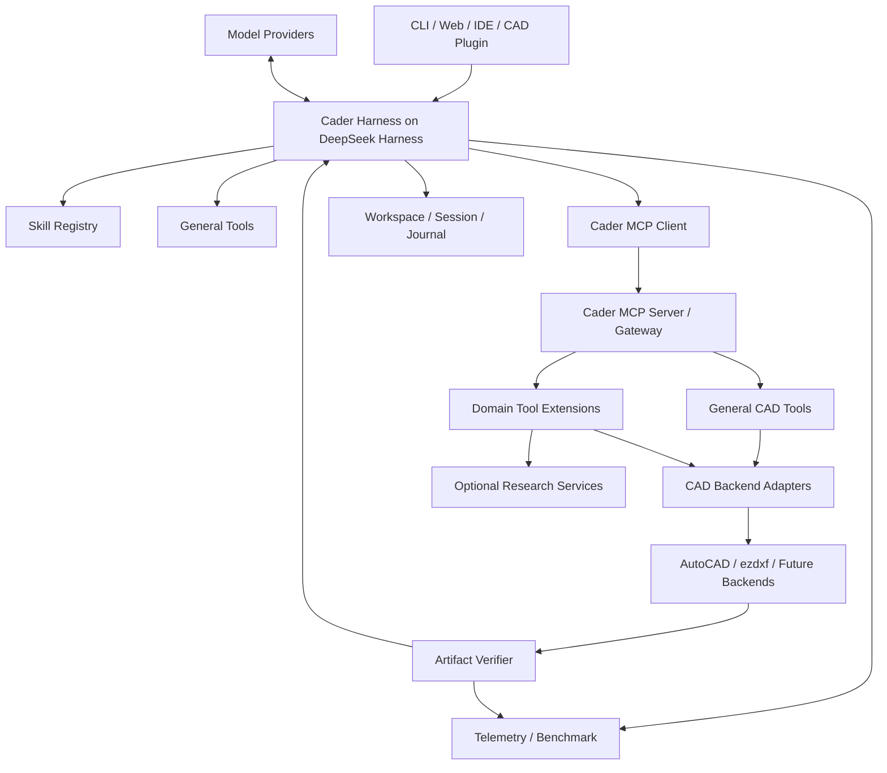
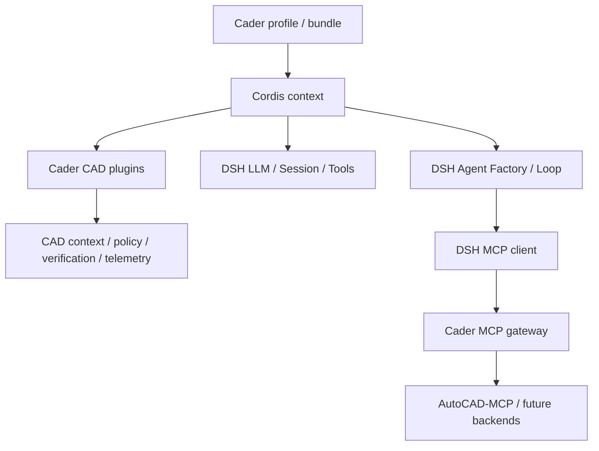

# Cader 技术设计文档（Technical Design Document）

> Cader — An extensible AI agent for computer-aided design.
>
> 文档版本：v0.2 · 2026-11-18 · 状态：Harness 选型已确定 / 实施待验证

## 1. 项目定位

Cader 是一个面向通用 CAD 场景的自主 AI Agent 平台。通过可替换的模型、基于 DeepSeek Harness 持续优化的 Agent Harness、统一的 CAD MCP、领域 Skill 和通用工具，完成图纸理解、生成、编辑、验证及交付等任务。

核心研发对象是 **CAD Agent Harness**，而非重新实现 CAD 几何内核，亦非堆积 MCP 工具。初期以 AutoCAD 为真实执行环境，优先复用已有 [AutoCAD-MCP](https://github.com/codesknight/AutoCAD-MCP)，逐步接入其他 CAD 软件。

### 1.1 领域边界

```text
Cader
├── Electrical CAD       # 首个专业扩展；当前研究数据仅覆盖变电站一次接线图
├── Mechanical CAD       # 未来扩展
├── Architectural CAD    # 未来扩展
├── Electronic CAD       # 未来扩展
└── General CAD          # 通用绘图、查询、编辑及文件能力
```

领域划分表示能力分类，不代表需要分别构建五个 Agent。General CAD 同时为其他领域提供基础能力。

电气图纸识别、检测、拓扑恢复、VLM 训练等学术研究独立开展，Cader 不负责维护研究数据集或训练模型。研究成果通过可选的领域扩展、模型推理接口、MCP 服务或 Skill 接入 Cader。研究模块不可用时，通用 Cader 仍应正常运行。

### 1.2 目标能力与非目标

| 能力 | 输入 | 输出 | 首版边界 |
|---|---|---|---|
| CAD Understanding | DWG/DXF、图像、PDF | 结构化信息、问答 | 优先原生 CAD 查询；图像能力按插件声明 |
| Text2CAD | 自然语言 | 可编辑图纸 | 基础二维绘图及简单组合 |
| Draft2CAD | 手绘草图 | 规范化图纸 | 可选实验扩展 |
| Image2CAD | 扫描图、截图 | 可编辑重建图纸 | 可选实验扩展，不承诺精确复刻 |
| CAD Editing | 图纸、修改需求 | 修改后的图纸 | 基础实体及图层编辑 |
| CAD Verification | 图纸、约束 | 检查报告 | 文件、实体、几何和回归检查 |

首版不做：自研大模型训练框架、通用几何求解内核、完整多智能体平台、所有 CAD 软件适配、生产级电气设计认证。不得将研究数据的覆盖范围表述为已支持全部电气领域。

## 2. 设计原则

1. Agent First：以真实任务完成率和工程产物为目标。
2. Harness Driven：以 DeepSeek Harness 为底座，领域优化有独立接口与实验记录。
3. Model Agnostic：模型选择由配置决定，支持能力探测和多模态差异。
4. CAD Agnostic：能力接口与软件后端解耦；不强行统一所有 CAD 内核语义。
5. Extension First：领域能力独立注册、启停、升级，不修改核心 Agent Loop。
6. Verification Driven：从真实产物读取状态，不以模型自述判断成功。
7. Safety by Default：默认只读或工作区副本写入，高风险操作审批，记录可追溯。

## 3. 总体架构



Cader MCP 是可独立部署的逻辑工具入口，可以由多个进程实现。领域扩展同时能够贡献 MCP 工具、Skill、资源、验证器或后端适配器；并非所有能力都必须通过 MCP RPC。Skill 与 Harness 不应从属于 MCP Server。

| 层 | 职责 | 不负责 |
|---|---|---|
| Harness | 模型循环、上下文、路由、生命周期、审批、恢复 | 具体 CAD API 细节 |
| MCP Gateway | 注册、发现、命名空间、权限、参数校验、调用分发 | 自主规划与模型推理 |
| Domain Extension | 专业工具、知识、资源、验证规则 | 强制修改核心循环 |
| Backend Adapter | 软件 API、文档状态、实际读写 | 领域推理 |
| Skill | 指令、SOP、参考资料、工具使用策略 | 强制安全保障 |
| Verifier | 独立验证工程状态与产物 | 为 Agent 的文本承诺背书 |

## 4. 技术选型与架构决策（ADR-0001）

**已确定：DeepSeek Harness 是 Cader 的 Agent Runtime。** 不再把 Deep Agents 或 Gemini CLI 作为待选底座；Gemini CLI、Codex 只作为架构参考及可选外部评测基线。

| 模块 | 技术决策 |
|---|---|
| Agent Runtime | DeepSeek Harness（DSH）+ Cordis 插件机制 |
| Agent 开发 | TypeScript / Node.js；版本遵循锁定的 DSH engines |
| TS 包管理 | pnpm workspace + pnpm-lock.yaml |
| CAD MCP | Python + MCP SDK；依赖通过 uv 锁定 |
| CAD 后端 | 首先复用独立 AutoCAD-MCP；后续按需 ezdxf、FreeCAD |
| 协议 | 本地 stdio，必要时 Streamable HTTP |
| 契约 | JSON Schema；TS 与 Python 各自校验 |
| UI | 初期沿用 DSH Web/headless，后续 Cader CLI / Web |
| 测试 | TS 测试框架待锁定，Python pytest；Windows 真实 CAD 测试独立 |

### 4.1 DSH 集成方案

DSH 将运行时能力划分为可替换服务，由 Cordis 装配。Cader 复用其 agent、agent-loop、tools、session、system-prompt、LLM adapter 与 MCP client，优先通过独立插件及 profile/bundle 实现差异，不复制整套运行时、不重写默认循环。需要修改核心时先记录失败证据，再通过服务替换或最小补丁解决。



### 4.2 上游扩展点与 Cader 责任

| 上游接口或机制 | Cader 使用方式 |
|---|---|
| Profile / bundle / patch | 定义 Cader 装配，复用 Web 与 headless 运行入口 |
| `ctx.agents`、AgentFactory | 复用默认任务执行；后续必要时替换 loop provider |
| `ctx.tools.register()` | 注册原生工具；MCP 工具优先由官方 client 注册 |
| `agent/pre-step` | 注入或整理 CAD 状态；按锁定版本契约实现 |
| `tools/pre-execute` | 写权限、预算、目标图纸、参数检查 |
| `tools/post-execute` | 记录结果、刷新状态、识别不确定写入 |
| `agent/turn-stopping` | 任务验收未完成时有限引导后续步骤，非无限循环 |
| Session events | 保留上游会话记录，补充 CAD 运行事件与产物引用 |
| LLM adapter | 多厂商模型；必须测试文本、视觉、tool-call 能力 |

以上为官方公开扩展机制与拟定映射；事件参数与返回类型不在本设计中臆造。waterfall 监听器必须按上游规则传递 `next()`；停止事件不是同一种 waterfall。先在锁定 commit 上编译并测试。

### 4.3 版本和风险

记录上游 commit / npm 版本、依赖锁、配置哈希与许可证于 `docs/adr/0001-harness-selection.md`。DSH 仍处开发预览期，默认禁用未审核动态插件、自修改运行时及不必要的 shell 能力。如果插件接口变化，只修改 Cader 的 DSH 适配层。升级必须通过相同 CAD smoke suite。选型已确定，但 Windows 支持、第三方 VLM、MCP 图像传递及取消行为尚未实测，列为 M0 集成门槛，而非重新选择框架。

## 5. 仓库结构

```text
Cader/
├── README.md
├── AGENTS.md
├── package.json / pnpm-workspace.yaml / pnpm-lock.yaml
├── apps/
│   ├── cli/                     # Cader doctor/run/bench，逐步实现
│   └── web/                     # 后续 Cader UI
├── packages/
│   ├── contracts/               # JSON Schema 与 TS 类型
│   ├── core/                    # 任务、工作区及编排入口
│   ├── dsh-adapter/              # 唯一直接依赖 DSH 内部接口的边界
│   ├── profile/                  # Cader profile / bundle / patch
│   └── plugins/
│       ├── cad-context/
│       ├── cad-policy/
│       ├── cad-routing/          # 基线后开发
│       ├── cad-verification/
│       └── cad-telemetry/
├── cader-mcp/
│   ├── pyproject.toml / uv.lock
│   ├── src/cader_mcp/
│   │   ├── server.py
│   │   ├── registry.py
│   │   ├── contracts/
│   │   ├── backends/
│   │   └── extensions/
│   │       ├── general/
│   │       ├── electrical/
│   │       ├── mechanical/
│   │       ├── architectural/
│   │       └── electronic/
│   └── tests/
├── skills/
├── configs/
├── benchmark/{tasks,fixtures,evaluators,runner}/
├── experiments/
├── tests/{unit,integration,e2e}/
└── docs/{adr,architecture,development}/
```

初期模块化单仓库，AutoCAD-MCP 继续独立维护。未来领域目录仅代表扩展点，不要求创建空实现。DSH 依赖通过 adapter/profile 装配；如果需要源码调试，独立 checkout 上游，不将其全部代码混入 Cader。

## 6. 核心契约

以下是 Cader 自有契约（非 DSH API），由 JSON Schema 跨进程共享。

```ts
export interface Task {
  id: string;
  instruction: string;
  workspaceId: string;
  domain: string;
  attachments: string[];
}
export type TaskStatus = "created" | "running" | "verifying" |
  "succeeded" | "failed" | "needs_input" | "cancelled";
export interface ToolResult {
  ok: boolean;
  data?: Record<string, unknown>;
  artifacts: string[];
  error?: { code: string; message: string; retryable: boolean };
  writeOutcome?: "none" | "committed" | "unknown";
}
export interface RunResult {
  runId: string;
  status: TaskStatus;
  artifacts: string[];
  verification?: { passed: boolean; report: string };
}
export interface CaderRuntime {
  run(task: Task, signal?: AbortSignal): Promise<RunResult>;
  cancel(runId: string): Promise<void>;
}
```

Python MCP 内部适配契约：`capabilities()`、`invoke(operation, arguments)`；Verifier 独立读取产物，输出指标、证据和失败原因。MCP 层按协议返回 content / structuredContent（版本支持时）及 isError，不直接假设 DSH 能消费自定义对象。限制图像和实体列表体积；大产物返回授权工作区引用，必要时通过图像 content 或模型适配器传递真实视觉内容。

状态：created → running → verifying → succeeded / failed / needs_input / cancelled。验证失败可在预算内修复；恢复前重新查询文档。对不能确认是否写入的操作返回 UNKNOWN_WRITE_OUTCOME，不自动重试。

错误码：UNSUPPORTED_CAPABILITY、INVALID_ARGUMENT、DOCUMENT_CHANGED、CAD_BUSY、TIMEOUT、PERMISSION_DENIED、VERIFICATION_FAILED、UNKNOWN_WRITE_OUTCOME。所有写操作绑定工作区、文档 ID、期望 revision 或等价指纹及 operation ID。

## 7. Cader MCP 设计

### 7.1 通用工具入口

```text
Cader MCP
├── general_*          # CAD 通用操作
├── electrical_*       # 可选电气专业工具
├── mechanical_*       # 未来
├── architectural_*    # 未来
├── electronic_*       # 未来
└── backend adapters  # AutoCAD / ezdxf / others
```

名称使用 ASCII 下划线前缀，避免后端或客户端对特殊字符的限制。实际工具名由注册表管理，记录来源、输入输出 schema、读写属性和所需 capability。禁止静默覆盖同名工具。

| 工具（计划） | 功能 | 类型 |
|---|---|---|
| general_get_capabilities | 后端能力发现 | 只读 |
| general_get_document | 当前图纸及单位、版本 | 只读 |
| general_list_entities | 分页或按区域查询 | 只读 |
| general_inspect_entity | 实体属性与引用 | 只读 |
| general_render_view | 受支持时生成预览 | 只读 |
| general_create_line | 绘制线段 | 写入 |
| general_create_circle | 绘制圆 | 写入 |
| general_create_layer | 新建图层 | 写入 |
| general_update_entity | 修改受支持属性 | 写入 |
| general_delete_entity | 删除指定实体 | 高风险写入 |
| general_save_as | 工作区内另存 | 写入 |
| general_apply_plan | 批量执行结构化操作 | 写入，后续实现 |

针对不同后端只暴露真实支持的工具。不要声称 ezdxf 原生支持 DWG 编辑，也不要将 COM 与 HTTP 当作互斥方案：COM 是 AutoCAD 执行接口，MCP stdio/HTTP 是传输方式。

### 7.2 后端与状态一致性

AutoCAD 的 COM 调用由适配器负责线程/应用实例管理、文档绑定、繁忙状态、异常规范化；同一文档写操作应串行化。首版不要自动创建多个 AutoCAD 实例。记下 document_id、revision 或等价状态指纹，避免误编辑用户当前打开的其他图纸。

Gateway 转发到已有 MCP 时，明确配置工作区和远端访问权限，不允许任意路径或任意命令透传。需要网络部署时增加认证、TLS、限流和审计，默认仅本地。

### 7.3 扩展方式

优先静态注册或可信本地插件，之后再支持 Python entry points。外部 MCP 通过显式配置接入。不要默认安装第三方仓库或执行其脚本。

```toml
# extensions/electrical/extension.toml（提案）
id = "electrical"
version = "0.1.0"
api_version = "1"
enabled = false
skills = ["skills/"]
required_capabilities = ["document.read"]
```

扩展可以提供 `register_tools`、`register_skills`、`register_verifiers`、`register_resources` 等入口。加载失败应隔离并记录诊断，不阻塞通用核心。不得用插件声明替代运行时权限校验。

## 8. Harness Engineering

默认循环：

```text
用户需求 -> 加载工作区及能力 -> 选择 Skill / 工具
    -> 模型规划与工具调用 -> 获取结构化观察 -> 检查任务状态
    -> 独立验证 -> 有限修正 -> 输出产物或明确失败原因
```

首版复用 DSH 默认 Agent Loop，仅实现必要的 CAD 插件、预算、工作区与验证；动态路由在基线建立后开发。后续按失败轨迹逐个优化：

| 模块 | CAD 定向优化 | 验证方式 |
|---|---|---|
| Observation | 图纸摘要、区域查询、实体详情、视觉预览 | 查询准确率、响应体积 |
| Context | 保留单位、坐标系、设计约束、实体引用；按需读取大图 | 长任务成功率、Token |
| Routing | 基础工具常驻，领域工具按需加载 | 误调用率、工具 schema Token |
| Planning | 显式依赖与批量计划；不强制所有任务先生成 IR | 执行成功率、调用次数 |
| Recovery | 检查点、操作日志、写入对账 | 故障恢复率、重复写入率 |
| Verification | 从最终文件或实际文档重新获取证据 | 假成功率、修复收益 |
| Memory | 项目参数、决策、可追溯工程状态 | 多轮编辑性能 |
| Subagent | 经验证后再引入领域专家路由 | 相比单 Agent 的实际收益 |

预算须可配置：最大模型轮数、最大工具调用、超时、最大修复次数、Token/费用（适用时）。触顶后返回部分产物和明确状态，不宣称成功。

CAD-IR 采用可选、分层策略：通用实体表示支持基础查询与编辑；Electrical/Mechanical 等领域自行定义专业语义。CADPlan 表达操作序列，两者不等价。保留原生 CAD 特性和引用，避免有损转换被当成真实图纸。

## 9. Skill 与通用工具

Skill 采用 `SKILL.md` + references/examples/scripts（按需）格式；内容按任务动态加载。Skill 不拥有安全权限，脚本必须经执行策略审批。

```markdown
---
name: cad-drawing
description: Create and edit basic 2D CAD drawings.
---
# Workflow
1. Inspect backend capabilities and document units.
2. Identify geometry and constraints.
3. Draw within the active workspace copy.
4. Verify saved artifact and report uncertainties.
```

首批 Skill：`cad-core`、`cad-inspection`、`cad-drawing`、`cad-editing`、`cad-verification`。专业 Skill 由领域扩展贡献。文件、搜索、图像、Python/Shell 等通用工具通过 Harness 接入并受工作区约束；不必为了统一而全部封装成 MCP。

## 10. 电气研究接入边界


当前只将变电站一次接线图作为首个专业验证场景；电气扩展应明确其能力声明、支持的设备类别、数据覆盖、置信度和无法识别项。研究接口可接收图像/图纸引用，输出版本化设备、连接、文字、几何及证据来源；具体 schema 由研究项目独立定义，Cader 通过适配层消费。

不将专用算法、训练代码、私有标注及数据集硬编码进核心。研究未完成时可用 mock fixture 验证插件接口，但不得将 mock 表现标作实际识别性能。电气工程图纸的施工及安全合规需专业审核。

## 11. 工作区、安全与产物

每次任务创建独立 run 目录：

```text
.cader/runs/<run_id>/
├── task.json
├── config.snapshot.json     # 脱敏
├── input/                  # 不可覆盖的原始输入副本
├── output/                 # CAD 产物与预览
├── events.jsonl
├── verification.json
└── summary.md
```

必须防止路径穿越、符号链接越界、任意脚本执行、误删文件及敏感信息泄漏。默认修改工作副本，覆盖原文件、批量删除及外部执行要求显式授权。图纸文字、网页、外部 Skill 和 MCP 输出均视为不可信数据，不能覆盖核心安全策略。日志不得保存 API key，记录模型和工具的可见事件、错误及状态；不要求采集模型隐藏推理。

当后端不支持原生事务时，采用工作副本和保存检查点，不承诺原子回滚。遇到超时、断线或部分写入，必须重新查询实际状态。

## 12. Cader-Bench

首版建立 10 个可自动验证的通用任务，后扩展至 30 个以上。不要依赖电气学术数据才能运行基础评测。

| ID | 任务 | 验证 |
|---|---|---|
| G01 | 创建图层 | 名称及属性 |
| G02 | 绘制指定线段 | 端点及容差 |
| G03 | 创建指定圆 | 圆心及半径 |
| G04 | 绘制闭合矩形 | 闭合、宽高 |
| G05 | 查询实体数量 | 对照 fixture |
| G06 | 按图层筛选 | 集合匹配 |
| G07 | 移动指定实体 | 坐标差值、无关实体不变 |
| G08 | 删除指定对象 | 目标不存在、无关实体不变 |
| G09 | 保存图纸 | 文件可重新打开 |
| G10 | 失败恢复 | 注入可恢复异常、核对无重复写入 |

任务使用 `task.json`、初始图纸、独立 verifier 与预期约束。Verifier 从实际保存产物或可信 CAD 状态提取证据；参考答案不必像素相同，允许几何等价。固定 DSH 基线，逐项引入 Cader 插件并进行配对实验。测试答案与评分逻辑尽可能不暴露给受测 Agent。

核心指标：任务完成率 = 通过任务/有效任务（无效环境任务单列）；假成功率 = 自报成功但未通过验证/自报成功任务；另记录 Token、耗时、调用次数、异常率和恢复率。报告同时公布基础设施失败与重试策略，防止筛掉失败场次造成偏差。

每次比较固定模型版本、提示词、后端、输入、预算、评分规则；记录 Git commit、配置哈希、随机种子（可用时）与全部试验。保留独立测试集，避免专门为评测题硬编码策略。

## 13. 项目初始化（Windows / PowerShell）

### 13.1 检查上游与运行环境

官方参考启动命令如下（只用于探索；将版本锁定后才用于正式开发）：

```powershell
node --version
pnpm --version
uv --version
npx @deepseek-ai/dsh web
```

可独立克隆上游用于源码阅读及扩展开发：

```powershell
git clone https://github.com/deepseek-ai/deepseek-harness.git
cd deepseek-harness
git rev-parse HEAD
pnpm install
```

先核对上游 package.json 的 engines、packageManager、README 和许可证，再使用其实际启动命令。记录当前 commit；上述命令未在本机执行。

### 13.2 创建 Cader 自有仓库

在上游目录之外执行：

```powershell
mkdir Cader
cd Cader
git init -b main
pnpm init
pnpm add -D typescript @types/node
New-Item -ItemType Directory -Force docs/adr, configs, packages, apps, skills, benchmark, tests
mkdir cader-mcp
cd cader-mcp
uv init --package --name cader-mcp --python 3.11
uv add mcp pydantic
uv add --dev pytest ruff
cd ..
```

在根目录编写 `pnpm-workspace.yaml`，包含 `apps/*`、`packages/*`、`packages/plugins/*`；将 root package 设为 private，添加 typecheck/test 脚本。DSH 依赖须使用所选版本的真实包名和精确版本：先读官方 cookbook 与包清单，不把示意包名当已发布 SDK。设置 Cader profile/bundle，使用上游公开装配入口；不复制上游配置中的密钥。

### 13.3 第一条链路：直接连接 AutoCAD-MCP

使用 DSH 官方 MCP client；每个服务一个 client 实例。官方支持 stdio 及 Streamable HTTP。具体配置外层和 patch 位置依锁定版本的 profile 示例，以下仅示意 client 的配置字段（不是完整可运行 Cordis YAML）：

```yaml
serverName: autocad
# 按现有服务实际传输选择 command/args 或 URL 配置
```

官方配置入口：[MCP client README](https://github.com/deepseek-ai/deepseek-harness/blob/master/packages/mcp/mcp-client/README.md)。真实工具发现后，以 `mcp__autocad__<rawName>` 暴露给模型。先连接已有 AutoCAD-MCP，不改变其协议；运行只读查询、工作副本绘图、保存及独立验证。第二阶段接入 Cader MCP Gateway，模型侧只保留 gateway 的 CAD 工具以避免重复暴露。Gateway 负责向真实后端映射，不重新实现 CAD 软件。

### 13.4 配置、开发命令与密钥

Cader 自有配置可使用 JSON，记录模型 provider、后端、workspace、预算、启用扩展与权限，并在 adapter 层映射到 DSH。API key 通过环境变量或本地安全存储提供。以下为待实现的 Cader CLI，不是 DSH 自带命令：

```bash
cader doctor
cader run --workspace ./demo "Draw a circle of radius 10"
cader inspect --run-id RUN_ID
cader bench --suite general-smoke
```

`.gitignore` 至少包含 `.env`、`.env.*`（保留 `.env.example`）、`node_modules/`、`dist/`、`.venv/`、`__pycache__/`、`.cader/`、`configs/local.*`。不提交私有图纸或密钥。新建远端仓库后再添加实际 URL 并 push；本指南不创建远端仓库。

## 14. 开发路线与验收

时间采用相对阶段而非承诺工期；以验收门槛进入下一阶段。

| 阶段 | 交付 | 验收条件 |
|---|---|---|
| M0 初始化与集成验证 | 仓库、ADR、DSH spike、连接诊断 | 锁定 DSH 版本；可发现并实际调用现有 CAD 工具 |
| M1 Cader MVP | CLI、模型适配、基础 MCP、工作区、日志 | 图纸读取、绘制、保存真实闭环；错误诚实返回 |
| M2 扩展化 | 通用 MCP Gateway、插件注册、Skill loader | 单独启动 MCP；启停插件无需修改核心；mock 扩展隔离测试 |
| M3 评测 | 10 个通用任务、独立 verifier、runner | 评测可复现，基线和失败轨迹完整；不依赖研究服务 |
| M4 Harness 优化 | 动态路由、结构化状态、验证反馈、恢复 | 与基线配对对照，不降低关键安全或正确性指标 |
| M5 专业扩展 | Electrical 可选接入及领域测试 | 仅对已声明的一次接线图能力验收；研究未就绪不阻塞主线 |
| M6 产品扩展 | Web、多后端、其他领域 | 每项由实际需求和评测决定，不一次性全做 |

### M0 必须验证的集成门槛

| 检查 | 通过标准 |
|---|---|
| DSH profile | 固定版本启动成功，可加载一个独立 Cader 插件 |
| 模型 | 至少一个真实模型正常调用工具；第三方 VLM 作为独立能力测试 |
| MCP | 正确发现 AutoCAD-MCP 工具、传递参数、保留错误状态 |
| 图像 | 使用真实 CAD 预览验证视觉模型实际收到图像；文本描述不算通过 |
| 写入与恢复 | 工作副本绘制、保存、超时对账，无重复实体 |
| 安全 | 外部脚本和跨工作区写入默认拒绝；取消状态不误报成功 |
| 事件 | 能关联 session / run / tool call / 文档及最终产物 |

发布 MVP 前至少 10 个通用任务逐一跑通；性能阈值基于首轮基线再设定，不预设未实测的成功率。

### 首批 GitHub Issues（建议）

- [ ] CADER-001：初始化 TS / Python workspace、CI、lint、测试、README、AGENTS.md。
- [ ] CADER-002：定义 Task/ToolResult/Capability 与错误码。
- [ ] CADER-003：AutoCAD-MCP smoke client 与连接诊断。
- [ ] CADER-004：实现 DSH profile / adapter spike，记录 ADR 与锁定版本。
- [ ] CADER-005：复用 DSH Agent Loop，验证模型与 MCP 图像传递。
- [ ] CADER-006：工作副本、权限、事件日志、执行预算。
- [ ] CADER-007：完成绘图、保存、真实产物独立验证。
- [ ] CADER-008：通用 MCP 工具注册与后端分发。
- [ ] CADER-009：复用 DSH Skill 机制 + 通用绘图 Skill。
- [ ] CADER-010：10 个任务的 Benchmark runner、报告与基线。
- [ ] CADER-011：插件加载、禁用和故障隔离测试。
- [ ] CADER-012：基于失败轨迹选择第一个 Harness 优化实验。
- [ ] CADER-013：Electrical 插件接口及 mock contract test（非学术研究实现）。

优先顺序：001 → 002/003 → 004 → 005/006 → 007 → 008/009/010；011 与 013 可独立推进，012 依赖基线。

## 15. 研发规范与 Definition of Done

每个 PR 说明任务、设计动机、边界、测试与兼容性；核心接口改变须记录 ADR。CI 至少运行 lint、单测及 fake backend contract tests；真实 AutoCAD 测试在专用 Windows 环境运行。默认不把 GUI 集成测试失败静默视为通过。

完成标准：功能真实可运行；有最少一个正常测试和一个失败测试；错误与日志清晰；配置和文档可复现；不泄漏秘密、不破坏原始图纸；新增 Harness 策略有基线对照或明确的后续验证计划。

### 推荐参考入口

- [Model Context Protocol](https://modelcontextprotocol.io/) — 协议及传输规范。
- [Agent Skills](https://agentskills.io/) — 技能封装规范。
- [DeepSeek Harness](https://github.com/deepseek-ai/deepseek-harness) — 已确定的底座。
- [DSH Architecture](https://github.com/deepseek-ai/deepseek-harness/blob/master/docs/architecture.md) — 服务、事件、profile。
- [DSH Extension Cookbook](https://github.com/deepseek-ai/deepseek-harness/blob/master/docs/cookbook/extension-cookbook.md) — 插件开发模式。
- [DSH MCP Client](https://github.com/deepseek-ai/deepseek-harness/blob/master/packages/mcp/mcp-client/README.md) — 工具发现与配置。
- [DSH Core](https://github.com/deepseek-ai/deepseek-harness/blob/master/docs/subsystems/core.md) — AgentFactory 与运行契约。
- [Gemini CLI](https://github.com/google-gemini/gemini-cli) — 生命周期与产品设计参考。
- [OpenHands SDK](https://github.com/OpenHands/software-agent-sdk) — 执行与事件体系参考。
- [Pi](https://github.com/earendil-works/pi) — 轻量执行循环与扩展设计参考。
- [AutoCAD-MCP](https://github.com/codesknight/AutoCAD-MCP) — 已有项目、首个运行环境接入。

DSH 官方架构、扩展与 MCP 客户端文档已查阅；尚未安装运行、确认精确 commit 或审计全部依赖许可。除已确定的 DSH 底座外，技术栈细节、目录和工具名称均为设计方案，非已完成实现。本文不会创建远程仓库或修改现有 AutoCAD-MCP。

## 16. 项目北极星

Cader = 可替换模型 + 持续优化的 CAD Harness + 统一工具与领域扩展 + 真实 CAD 环境。

以通用能力为核心，以实际工程任务驱动 Harness 优化，以独立评测衡量收益。电气学术研究是首个可接入的专业方向，不是整个项目的范围或研发前置依赖。
