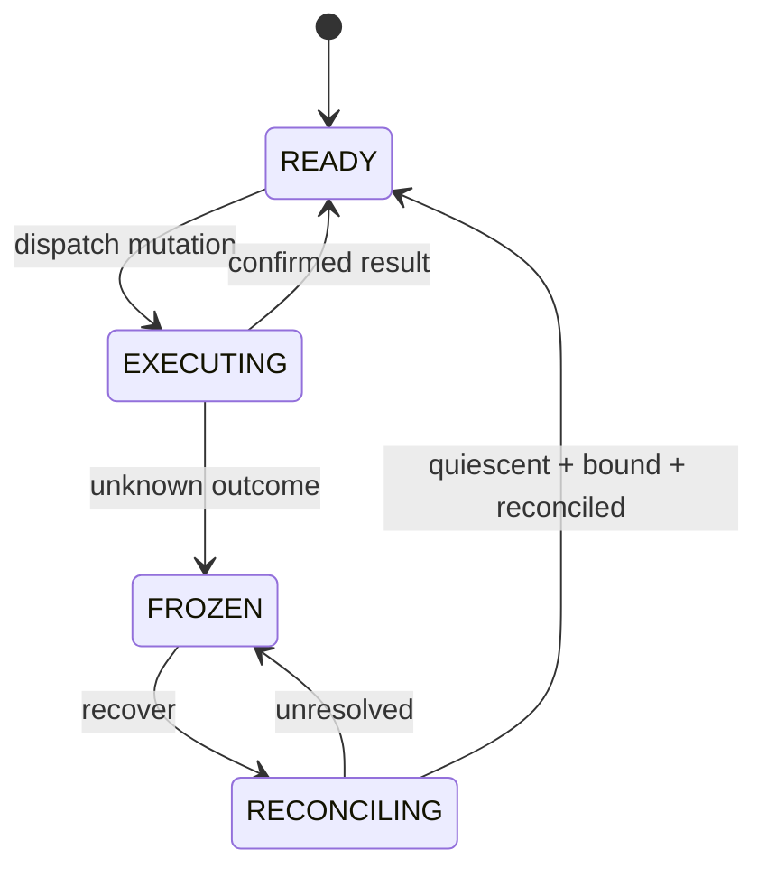
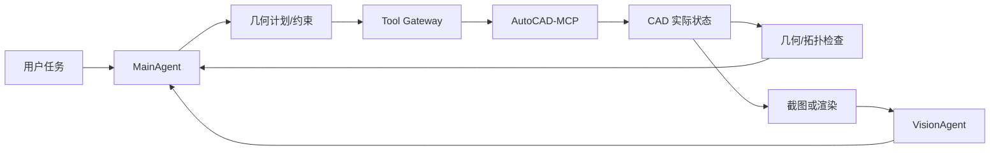

# Cader v0.4.0 研发指导：可靠执行、视觉反馈与自主纠错

> 文档用途：直接交给研发 Codex，作为跨仓库排障、实施和验收的任务说明。  
> 基线：Cader v0.3.0，2026-11-20 01:30–01:54 CLI 日志（629 行展示内容）。  
> 仓库：[Cader](https://github.com/codesknight/Cader) · [AutoCAD-MCP](https://github.com/codesknight/AutoCAD-MCP)  
> 状态：待实施。本文中的新工具、接口、命令、阈值均为建议，不代表当前已实现。

## 1. 研发目标与边界

Cader 已能通过 DeepSeek Harness 自主调用 AutoCAD-MCP，完成新建图纸、绘制及后续编辑。下一阶段不是重建 Agent，而是将已经打通的执行链路升级为稳定、可观测、可恢复、可验证的 CAD Agent。

优先级：**Reliable Execution → Visual Feedback → Self-Correction → Harness Optimization**。

- 保留现有 DeepSeek Harness、CLI、MCP 管理、权限系统及已有 Scheduler；先阅读源码，再决定最小改动范围。
- AutoCAD-MCP 是独立执行后端；Cader 是通用 CAD Agent，负责理解、规划、调度、反馈与任务完成判断。
- 不把电气接线图研究的场景限制写入通用主 Agent；电气符号及拓扑规则应由可选 Skill 或领域验证器提供。
- 不通过增加全局禁止提示词来解决执行故障，不绕过现有审批、文档绑定与文件保护。
- 不以固定任务脚本、模拟结果、单元测试数量替代真实模型自主执行的验收。

## 2. 日志事实与问题清单

行号指用户提供的日志展示行号；表中模型转述不等同于原始 MCP Response。

| ID | 优先级 | 日志证据 | 问题与影响 |
|---|---|---|---|
| E01 | P0 | L11–15：MCP connected，44 工具发现，Agent CAD 27 工具，COM，CAD not_probed | MCP 连接与 CAD 就绪状态混淆；启动状态不足以证明 CAD 可写 |
| E02 | P0 | L295–395：电路绘制前半段成功，01:33:48 连续五次 draw_line 失败 | 首次写入异常后进入冻结；实际触发原因未知 |
| E03 | P0 | L383–394：模型报告失败批次有一条实际写入，之后补画及文字仍失败 | 存在结果未知与部分副作用风险；不能盲目重放 |
| E04 | P0 | L423、L530–546：worker_running、documents=[]、bound_document_id=null、not_probed，但查询成功 | 状态接口与执行结果不一致，需区分缓存、未探测、真实未绑定等情况 |
| E05 | P0 | L503–595：约20分钟后新建图纸仍失败；换模型无效 | 冻结未恢复，缺少可调用恢复链路 |
| E06 | P1 | L82–130：屋顶最高 y=6500，阁楼圆窗中心 y=8800、R=400 | 圆窗完全在屋顶外；几何错误未被发现 |
| E07 | P1 | L153–175：query_entities 后宣称绘图完成 | 实体存在性校验不能代替语义、布局及几何验收 |
| E08 | P1 | L225–286：8次 draw_text 成功标记，先报告7条，后报告8条 | 模型统计与执行审计不一致 |
| E09 | P1 | L397–431、L536–542：电路未闭合，5V 未写入，线段描述前后变化 | 任务未完成；缺少可靠几何与拓扑状态来源 |
| E10 | P1 | L494–501、L597–603：VisionAgent 可选；模型称 export_current_view 未暴露 | 视觉模型配置不等于已具备 CAD 图像观测能力，需核验后端导出与图像传递 |
| E11 | P1 | L62–150：房子任务9次写审批；L317–373：大量原子绘图调用 | 粒度过细，存在审批与调度开销；需要安全批量操作 |
| E12 | P1 | L195–204、L200：full-access 仍限会话新建工作图；任意 DWG 打开及 undo 未实现 | 权限语义需一致，现有工程编辑能力不足 |
| E13 | P2 | L459–470：仅两个旧只读/规划 Skills；L494–501：手动切换模型 | 实际绘图和自动视觉验证缺乏操作知识及路由 |
| E14 | P0 | 全局日志主要只有 CallToolRequest 和成功/失败符号 | 缺首发异常栈、原始请求响应、操作生命周期及关联ID，无法确定根因 |

### 2.1 已确认与未确认

已确认：CLI 展示了成功与失败标记；房子圆窗参数确实错误；冻结后多个写调用失败且读调用仍成功；视觉验证没有执行。模型报告的实际实体数、部分写入、错误码细节及后端状态需要与原始工具响应对照。未提供真实 DWG、完整后台日志以及当前源码，因此**不得将并发冲突、COM 故障、revision 冲突或文档绑定错误直接定性为最终根因**。

## 3. P0：首先定位首次冻结，而非修饰后续报错

### 3.1 Codex 首轮源码审计

分别检查两个仓库当前分支、commit、未提交改动、AGENTS.md、README、测试和运行配置。不要覆盖用户的未提交修改。

全局定位以下符号（名称以源码为准）：`OUTCOME_UNKNOWN_FROZEN`、`OUTCOME_UNKNOWN`、`worker_running`、`not_probed`、`bound_document_id`、`get_backend_status`、`draw_line`、`new_drawing`、Tool Registry、Scheduler、COM worker、工具并行执行入口。

输出实际文件路径/行号和调用链，回答：

1. 冻结由 Cader Gateway、MCP 服务、COM worker 还是其他层设置？冻结范围是会话、连接、文档还是整个后端？
2. 01:33:48 的五个失败是否属于同一个 LLM tool-call batch？是否并行提交？第一个异常是什么？后四个是否未进入服务端？
3. 首次未知结果发生在写入之前、COM 执行期间、返回传输还是写后校验？是否存在延迟提交？
4. preflight / mutation / postflight 是否使用相同文档及 revision？多个客户端是否可能交错？
5. COM 对象是否固定在拥有正确 apartment 的 worker 线程中？是否有超时、取消后后台仍执行或 RPC busy 问题？
6. status 返回空文档是未探测、过期缓存还是实际绑定失败？查询是否偷偷使用 ActiveDocument？
7. 为什么冻结后未自动进入恢复路径？错误码是否把首个 UNKNOWN 与后续 BLOCKED 混为一谈？

### 3.2 可观测性（两仓库）

先增加贯穿 Cader→MCP→COM 的关联 ID，再复现。CLI 保持简明，研发 JSONL 单独落盘；禁止记录密钥、未经授权的图纸全文等敏感数据。

建议每次调用记录：

```json
{
  "session_id": "...",
  "task_id": "...",
  "turn_id": "...",
  "batch_id": "...",
  "tool_call_id": "...",
  "operation_id": "...",
  "tool": "draw_line",
  "stage": "preflight|dispatch|commit|postflight|reconcile",
  "document_id": "...",
  "revision_before": null,
  "revision_after": null,
  "worker_thread_id": null,
  "queue_wait_ms": null,
  "duration_ms": null,
  "outcome": "unknown",
  "error_code": "...",
  "hresult": null,
  "exception": null,
  "affected_entities": []
}
```

同时记录模型原始 tool_calls 及合法的 MCP 请求/响应（脱敏）、是否实际 dispatch、调用开始和结束时间、锁获取/释放、冻结原因与状态迁移。若 COM 无可靠 revision，明确其不可用，不要伪造；可采用文档标识与实体快照、后端操作流水辅助判断。

### 3.3 控制变量实验

统一 AutoCAD 版本、后端配置、图纸模板、坐标序列；每轮使用隔离草稿，记录 commit 和环境。每个实验建议至少3轮。以下数量是初始验收设计，不是已有测试结果。

| 实验 | 方式 | 判断 |
|---|---|---|
| A | 独立 MCP client 串行画100条线，绕过 Cader | 后端是否独立复现 |
| B | Cader 使用确定性 tool-call 序列，串行100条线 | Gateway/Scheduler 是否引入故障 |
| C | 同轮提交多个写请求，仅在隔离草稿测试 | 并发/批次是否触发异常 |
| D | B 与每次间隔500ms对照 | 请求节奏、CAD busy 是否有关 |
| E | 连续新建10个图纸，各绘制10条线 | 文档绑定、切换与生命周期 |
| F | 注入写前失败、写后响应丢失、超时及取消 | 未知结果、部分成功与恢复正确性 |
| G | 同一房子/电路任务，用真实模型与固定计划对照 | 区分模型规划与执行故障 |

先运行 A/B/E，捕获首发错误，随后依据证据选择 C/D/F。不要靠随意增加 sleep 掩盖竞态，不要为了修复而直接换 HTTP 后端；COM/HTTP 对比应在故障定位后进行。

## 4. P0：可靠写入与可恢复执行

### 4.1 调度约束

- 同一图纸默认单写者；涉及 ActiveDocument 切换、new/open/save 等操作也要纳入相应连接级互斥。
- 在 AutoCAD-MCP 保证真实 COM 操作进入合法线程/队列；Cader 层负责批次顺序和策略，不以 Cader 锁替代后端约束。
- preflight、写入、结果确认必须针对同一可信文档标识；与下一次写入的状态校验不得交错。
- 检测到未知结果时停止后续 mutation；返回明确 `not_dispatched` / `blocked`，不得把未执行操作都标为结果未知。
- 查询可在安全一致性边界继续；不能通过切换模型、full-access 或普通 reconnect 绕过冻结。

### 4.2 操作结果模型与恢复状态机

建议区分：`committed`、`failed_before_dispatch`、`failed_no_effect_verified`、`unknown`、`blocked_not_dispatched`、`partial`。



恢复步骤：阻断新写入→确认旧请求已经结束或不会再提交→探测后端与目标文档→对账操作记录和实体变化→判定成功/无副作用/仍未知→明确允许继续的操作→恢复队列。仅实体数量一致不足以证明没有副作用；应使用操作 ID、可用的实体标识和属性比对，必要时要求用户确认。若无法证明安全，保持冻结并提供明确诊断，不自动关闭或重启用户正在使用的 AutoCAD。

恢复建议接口（需先复用已有能力）：`cad_get_health`、`cad_probe_connection`、`cad_reconcile_operation`、`cad_rebind_document`；CLI `/mcp doctor`、`/mcp reconnect`、`/mcp recover`。重新绑定或重连不等于自动清除未知操作记录。

### 4.3 状态接口

区分 MCP transport、worker、CAD connection、文档绑定、读能力、写能力、冻结原因。启动执行非破坏性探测；如果仅能确认服务进程，显示 `not_probed` 而不是 CAD ready。将状态来源、更新时间及是否缓存返回给模型和 CLI。

## 5. P1：几何规划、批量执行、交互体验

保留原子工具，增加结构化批量几何接口（建议 `execute_geometry_batch`），内部串行、逐项验证与审计。每项提供 operation_id、结果和实体标识；明确是否原子事务，无法保证回滚就返回部分成功，未知结果立即停止。禁止暗中引入无约束 COM/AutoLISP 逃逸接口。

Agent 先规划再执行：通用 scene/geometry plan 描述实体、图层、相对布局、约束和验收条件。简单任务不强制复杂领域 IR，复杂任务使用组件、端口、关系等抽象。计划由 LLM 自主产生，程序负责 schema、有限数值、合法参数及可验证的约束。

房子回归：墙体 (0,0)–(6000,4000)，屋顶顶点 y=6500；圆窗中心 (3000,5000)、R=400 是一组**示例修正**，不是唯一答案。应检查圆完全位于三角屋顶内部，而不只是存在一个圆。圆窗错误在执行前应被捕获，或执行后被自主修复。

电路回归：模型可自由布局，但必须表示电源和灯泡的两个端口，并连接成闭合串联回路；导线连接检查基于端点容差、组件端口和网络拓扑，而非仅看线段数；文字 `5V` 必须存在且邻近电源。电气规则放入可选 schematic Skill/Verifier，不锁死通用 Agent。

权限体验：ask 模式支持针对明确目标和操作列表的一次批次审批；计划变化或风险升级重新审批。workspace-write/full-access 保留文档保护；清楚展示有效权限（含 Shell ask/deny 的优先级）。任意 DWG 打开、已有图纸编辑、保存与 undo 后续独立实现，不能假装已有。

## 6. P1：视觉感知与自主纠错

先核对真实模型 endpoint 是否接收图像、实际消息适配是否保留图片，以及后端是否真正实现 `export_current_view`。模型配置 `text/image` 和模型别名均不是多模态能力的充分证据。



- AutoCAD-MCP 提供可调用的当前视图导出、完整范围观察和区域渲染；具体名称复用已有接口。记录文档标识、视图范围、图像尺寸、坐标映射和快照时刻。
- Cader 将图片真实传给支持图像输入的模型，而不是仅把本地路径作为字符串传入；支持 MainAgent 自动委派，无需手动 `/model`。
- 用户未上传参考图仍可验证生成结果；参考图仅在比对任务需要。若后端可安全读取当前视图，不强制先保存 DWG；导出文件需遵守文件写入策略，改变 CAD 视口的操作需按副作用分类。
- 几何写冻结时，允许安全的只读观察（前提是没有在途操作造成不一致），不得为导出绕过保护。
- VisionAgent 输出结构化缺陷：类型、严重度、位置、证据、修正建议；像素定位需映射至 CAD 坐标或通过实体查询定位，不直接凭像素删除实体。
- 修正后再次查询和渲染；设置有限纠错轮数（建议3轮，可配置），避免无限循环。不能纠正则明确部分完成。

## 7. P1：独立验收与可信任务报告

区分五层检查：工具结果、几何约束、领域拓扑/语义、视觉质量、文件持久化。未执行标记 `not_run`，不默认通过；不要求每个任务都必须保存文件，只有用户要求或任务需要时才执行保存及重开验收。

建议由 Harness 从工具审计及验证器生成事实再交给模型解释：

```json
{
  "task_status": "partial_failure",
  "document": "Drawing8.dwg",
  "verification": {
    "execution": "failed",
    "geometry": "incomplete",
    "topology": "failed",
    "visual": "not_run",
    "file_persistence": "not_run"
  },
  "missing_requirements": ["closed_circuit", "voltage_label_5V"],
  "backend_state": "write_frozen"
}
```

此 JSON 为依据日志现象拟定的报告示例，非原始系统返回。实际报告统计需来自可信 operation ledger；失败调用可能有副作用，工具成功次数也不保证实体数量。每项用户要求应关联验证证据。避免模型自行编造数量、图层、坐标或成功状态；区分尝试、提交、确认成功和未执行。

## 8. P2：Skills、模型路由与 Benchmark

P0稳定后再扩展 Skills：cad-fundamentals、cad-drawing、cad-editing、cad-visual-review、cad-recovery、cad-file-management；按需加入 electrical-schematic、architectural-drawing。清理旧 Skills 中与当前可用工具或权限不一致的全局禁止语句，但权限始终由程序执行层决定。

主 Agent 根据任务和失败类型选择 Skill 或视觉模型；比较 Flash 与 Pro 时固定工具集、权限、任务和后端状态。记录实际模型及图像输入是否成功。不要试图通过换大模型修复 scheduler 冻结。

建立 benchmark：基本几何、布局约束、编辑现有对象、多轮任务、文字与图层、简单电路、异常恢复、视觉纠错。统计任务成功率、几何/拓扑正确率、首发冻结率、恢复成功率、工具调用/审批数、时延与 token 成本；报告实际分母及失败样例。

## 9. 跨仓库职责与实施顺序

| 阶段 | AutoCAD-MCP | Cader | 出口条件 |
|---|---|---|---|
| M1 / P0 | COM追踪、状态探测、独立复现 | Tool-call trace、批次审计 | 捕获首个异常，证据定位层级 |
| M2 / P0 | 正确线程/队列、文档绑定、操作结果及恢复 | 串行调度、冻结阻断、对账与恢复入口 | 连续写入与故障注入验收通过 |
| M3 / P1 | 批量几何、查询和视图导出 | 自主几何计划、批次审批、图像传递 | 房子与电路真实任务通过 |
| M4 / P1 | 提供可核验实体及快照 | 独立验证、VisionAgent 自动路由与纠错 | 缺陷被检测并修正，报告准确 |
| M5 / P2 | 补充工程文件能力 | Skills/Benchmark/性能优化 | 重复实验与对照结果可追踪 |

提交应小步、可回归，先修复已证实的问题再扩展。任何协议 breaking change 同步修改两个仓库及兼容性测试。

## 10. v0.4.0 验收清单（建议门槛）

- [ ] 启动能分别报告 MCP、CAD、文档、读写就绪状态，未探测不冒充已连接。
- [ ] 真实 Windows AutoCAD 环境下，串行100次写操作连续3轮，无未解释冻结，实体结果与计划逐项吻合。
- [ ] 连续10次新建图纸，每张绘制10个实体；不得写错文档或覆盖用户工程。
- [ ] 人为注入写后响应丢失、取消、超时；未确认前不写入，无重复副作用；能对账则恢复，否则保持冻结并清晰报告。
- [ ] 同轮多个 tool calls 触发可靠调度；未知结果后剩余未派发请求准确标记。
- [ ] ask / workspace-write / full-access / read-only 与 Shell 策略实际生效，包括拒绝路径与批次审批。
- [ ] 真实 LLM 自主新建并绘制房子，屋顶、窗、门位置合理；多轮添加文字，实际数量与报告一致。
- [ ] 真实 LLM 自主绘制电源+灯泡的闭合串联电路，5V 文字正确，拓扑程序验收通过。
- [ ] MainAgent 能观察 CAD 生成图像并自动调用视觉模型；记录图片输入证据而非路径字符串。
- [ ] 注入圆窗漂浮等可见缺陷，能报告并在授权下修正，再进行验证；失败如实返回。
- [ ] 用户要求保存时独立核验输出文件；重开验收若未支持，明确标为未执行，不宣称通过。
- [ ] 提供原始脱敏日志、真实视图截图、测试结果、失败案例、commit 和复现命令。

门槛为初始建议，可根据真实环境和性能基线调整，但不应删除结果未知、文档保护和真实任务正确性的验收项。

## 11. 给 Codex 的工作指令

请以本文件为研发任务说明，而不是将本文的猜测当作代码事实。

1. 首先审计两个仓库，输出真实架构、冻结触发位置、待验证假设和最小复现实验；优先解决 P0。
2. 先补可观测性并尝试复现，保留原始错误码和异常栈，再基于证据实施最小修复；如发现根因不同，更新本文件中的诊断和方案。
3. 实施每一项功能时同步增加测试、更新 CLI/help、配置说明、权限契约和跨仓库调用文档。
4. 真实 CAD 验收必须使用隔离草稿、明确目标文档；禁止用模拟成功结果替代真实执行。无需重新询问已给定的架构方向。
5. 若当前环境无 Windows/AutoCAD/模型凭据，则完成能执行的静态审计、单元测试及复现脚本，清楚标明哪些实机验收尚未运行，不伪造日志或结论。
6. 最终交付：根因分析（证据与置信范围）、修改文件及 commit、复现步骤、测试矩阵及实际结果、未解决问题、后续任务清单。

**成功标准：Cader 能够可靠地执行用户要求，感知 CAD 的真实状态，发现自己的错误并安全纠正，而不是仅仅输出工具调用成功或一份看似完整的总结。**
