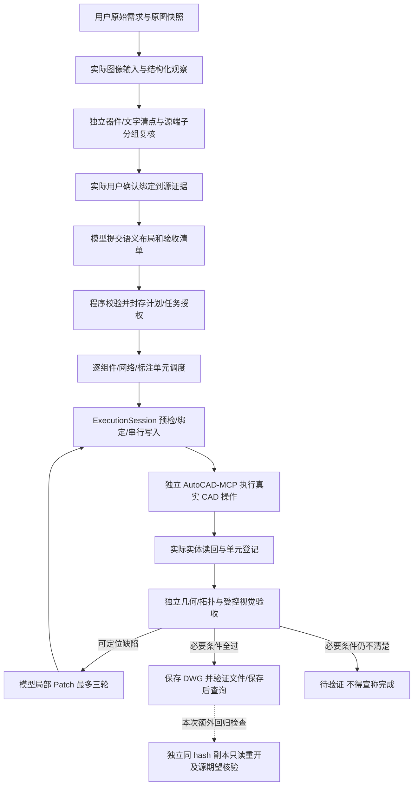

# 复杂手稿重绘成功的工程复盘与后续缺口

日期：2026-11-25（Asia/Shanghai）。需求：REQ-046，关联 [Cader #20](https://github.com/codesknight/Cader/issues/20)，Milestone 3。来源：用户对修复方法、标注反复存疑、上下文上限、主动澄清及 AutoCAD-MCP 协同的五项追问。

本文审阅代码基线 `37144cc`（实现代码截至 `c9a17dd`），本轮只做源码/既有证据审计、研发方案及协同建议，不宣称已实现下面提出的新功能，不重新调用付费模型或改动现有图纸。实测原件、私人图纸和问答留在 `.cader/runs/`，不在公开文档复制原稿内容。

## 一、直接回答：成功依靠哪些改变

成功来自代码约束、动态上下文、真实工具执行、用户澄清和独立验收的共同作用。提示词帮助模型使用这些能力，但权限、预算、拓扑、完成状态均由程序检查。未替换 DSH/Cordis，未写一个绕过模型的固定绘图脚本。

| 层次 | 实际改变 | 没有因此获得的保证 |
|---|---|---|
| Harness/类型与调度代码 | 多端口/netlist、源图与目标绑定、语义单元、检查点、预算交接、报告一致性 | 不等于模型永远识图正确 |
| 执行层 | 原始 MCP schema 预检、串行写入、任务授权、真实查询、文件保护及写入审计 | 工具 ACK 不等于整图验收 |
| 动态提示/工具装配 | 每阶段工具集、封存图层/符号条件、当前单元、实际读回、未通过原因和预算 | 文字规则不能解除 unknown 屏障 |
| 图像与模型观察 | 真正传入原图像素及裁图变换，清点器件、端子、文字并复核连接 | 观察报告仍是证据候选，不是自动真值 |
| 用户确认 | 将实际答复绑定到原图位置/hash与原始引用，保留原识别结果 | 不能声称所有标注是无辅助 OCR 成功 |
| 独立验证 | CAD 实体/拓扑、原图对照、DWG 同 hash 副本只读重开、独立期望/外观 | 本例通过不能推出任意图都通过 |

本例全部 9 处文字值以及一处模糊连接由用户确认。确认解决了原稿歧义；代码解决了如何稳定执行、追踪并验证这些决定。不能把两者混为“模型终于自己看对了”。

## 二、实际执行链路



其中的独立 DWG 重开是本次额外回归步骤；不能据此把“每次 CLI 保存都会自动重开”写成已实现行为。

### 1. 输入必须是实际像素，且整个任务绑定同一原图

路径先导入私有参考图快照，记录 hash、尺寸、原始方向及裁图坐标变换。传给视觉模型的是实际附件图像，不是只有文件名的提示词。每次关键推进前检查原图未变化。原图像素坐标 y 向下，CAD 布局 y 向上，程序负责转换并保留证据。

来源：[reference-input.ts](../../packages/profile/src/reference-input.ts)、[image-view.ts](../../packages/dsh-adapter/src/image-view.ts)、[live.ts](../../packages/dsh-adapter/src/live.ts)。

### 2. 先建立语义关系，再让模型选择几何和工具

旧的“两端器件串联闭环”不能表示带晶体管、分支和公共回路的图。现有计划允许每个组件 1～8 个端口，`ports`、`pin_names`、`source_terminals` 同序；每个端口必须且只能属于一个外部 net。晶体管三个引脚不会在算法里被当成内部短路。

源网复核使用逐端子 membership：已知每个端子在 schema 中必填，分组数组由程序派生，减少模型重复/遗漏 pin。源图观察与复核有明确冲突时，先复核，不把初稿或多数意见直接当真值。封存计划不得丢端口、偷换源端子分组或把分支电路降为串联。

下例仅为合成结构，**不是原稿网表或绘图序列**：

```json
{
  "component": {"id": "T1", "pin_names": ["B", "C", "E"]},
  "nets": [
    {"id": "input", "pins": ["T1:B", "X1:out"]},
    {"id": "upper", "pins": ["T1:C", "X2:out"]},
    {"id": "lower", "pins": ["T1:E", "X3:in", "X4:in"]}
  ]
}
```

`source_layout:true` 复用的是模型观察并经过复核的源对象/端子/分组，程序作坐标转换、近似端口边界投影并记录投影；它不包含预设 CAD 操作。Main 仍自主选择线段、圆、多段线、文字、坐标细节及工具调用。原图布局不是物理比例尺认证。

来源：[quality.ts 配置与 schema](../../packages/config/src/quality.ts)、[reference-input.ts](../../packages/profile/src/reference-input.ts)、[Harness quality.ts](../../packages/profile/src/quality.ts)。

### 3. 用确定性算法核对实际 CAD，而不是只比较两个模型结论

`verifyNetlist` 读实际 AcDbLine/端口坐标，用并查集计算外部导线分区，再与封存 netlist 逐 pin 对比。端点和 T 接触可连接；仅内部交叉不自动连接。明确声明的内部接点还需要实际几何标记，不能仅靠计划里写了一个坐标。

同时检查端口是否有真实符号引线接触、孤立线、悬空端、重复/正长度重叠线、错误连接及不支持/非平面的导线。多段线的 bbox 不能证明它接到端口；符号需要可读回的端点/引线证据。当前外部导线验证限于支持的二维直线表达，并非全类型 CAD 拓扑或电气仿真。

来源：[netlist.ts](../../packages/profile/src/netlist.ts)、[quality.ts 的 verifyQuality](../../packages/profile/src/quality.ts)、[branched-netlist.test.ts](../../tests/unit/branched-netlist.test.ts)。

### 4. 不让一个模型响应推演完整张图

Harness 从模型的语义计划派生 setup、组件、网络、标注批次。每阶段仅暴露相关工具，单个 Patch 最多 8 项，写操作串行；每个单元先读回实际几何/文字，完成后再次读回并登记。图层、符号形态和文字条件逐单元传递，避免计划要求一种图层、实际画到另一层。

全单元登记仅证明进度，后续仍必须几何、拓扑、视觉和文件验收。Patch 的整批 schema 预检不等于原生事务；后续几何/权限检查可能拒绝某一项，此前确认的项必须保留，模型只补未执行部分。

来源：[quality.ts](../../packages/profile/src/quality.ts)、[execution.ts](../../packages/profile/src/execution.ts)、[tool-validation.ts](../../packages/dsh-adapter/src/tool-validation.ts)。

### 5. 恢复的是执行进度，不是拼接模型残缺文本

绘制/修正遇 OUTPUT_TRUNCATED、MALFORMED_RESPONSE、模型响应 TIMEOUT 时，先保存账本和检查点，核对原连接、目标工作图及所有权，再实际查询实体。每个独立单元最多 2 次响应恢复；无单元任务保留全任务 2 次。规划/确认阶段仅允许一次紧凑重试，配额/鉴权错误不适用。

恢复后重新请求短批，不拼残缺 JSON，不重发已确认写入。恢复发给模型的历史只保留最近 8 项及完整读回摘要；原始完整账本仍保存。单元恢复次数与任务累计次数分别展示。

单轮工具/CAD 额度可通过 Scheduler 安全交接续轮，任务总 token、时间、操作限额不重置。unknown 写入先对账，不能靠继续、压缩或新会话解锁；已 ACK 后读回失败与未 ACK 的 unknown 分开处理。

来源：[budget.ts](../../packages/dsh-adapter/src/budget.ts)、[quality.ts](../../packages/profile/src/quality.ts)、[truncation-recovery.test.ts](../../tests/unit/truncation-recovery.test.ts)、[operation evidence ADR](../adr/0009-operation-evidence-and-observation-recovery.md)。

### 6. 视觉入口统一，程序保留最终完成权

Main 可主动调用受控视觉入口；遗漏时 Harness 补验。复用条件绑定同一任务、连接、图纸、当前实体摘要/写记录及原图；写后旧结果失效。检查保存图像 hash、截图恢复/清理回执、要求清单、源端子复核和报告。

Schema 有效、视觉判定通过、所有必要清单通过是不同条件。全部必要条目 pass 却给整体 uncertain 的矛盾报告，即使带 minor 建议也会被拒，要求模型在同图有限修复：指出真实受影响条件，或重新提交一致报告。程序不直接把 uncertain 改成 pass。真正不清楚仍必须待验。

也不能把源图问题、CAD 问题、可选美化混在一起：用户已确认的源图歧义不应被反复当作未解决问题；实际 CAD 未达到确认值则必须修 CAD。手绘只是输入媒介，不自动增加手写字体、铅笔笔触等输出要求。

来源：[live.ts](../../packages/dsh-adapter/src/live.ts)、[VisualReport 校验](../../packages/config/src/quality.ts)、[visual-outcome.test.ts](../../tests/unit/visual-outcome.test.ts)。

## 三、为什么仍需要独立期望和真实重开

曾出现一次“自动清单全过、DWG 原生数据也匹配”，但符号换成了另一种制式。原因是模型可能同时误定目标、误判结果；几何只证明 CAD 满足既定计划，不能证明这个计划忠于原图。

因此最终回归另外使用未输入模型规划的独立源期望，并人工对照原图与实际截图。期望在执行结束前位于模型工作区之外，不参与生成 CAD 操作。原始失败仍保留，没有回改为成功。

| 最终原稿回归证据 | 已核验结果 |
|---|---|
| 私有 run | `quality-b26b38fa-4cf7-44d9-ae73-b464ac8a1f83` |
| Cader 必要验收 | 12/12，23 个语义单元 |
| 原生写入 | 76 committed，0 unknown |
| 真实异常交接 | 同一单元两次 MALFORMED_RESPONSE 恢复、一次预算续轮 |
| 累计用量 | 964050 reported tokens；未提高单次 8192/总任务 2M 阈值 |
| 视觉 | 一次受控截图、两次最终视觉模型请求，有效 pass |
| DWG | 20474 字节，同 SHA256 副本在 AutoCAD 只读打开 |
| 原生实体 | 71：54 直线、6 多段线、2 圆、9 文字；审计/几何/文字一致 |
| 独立源期望 | 8 组连接、9 处标注、10 项原生检查、原符号三角轮廓通过 |
| 保全 | 5 项旧证据与原图 hash 未变，其他已开文档几何/打印设置未变 |
| 检查层级 | 203 离线测试、typecheck、DSH 组件 smoke、真实 Cader/模型/CAD；未冒充上游完整 DSH app profile |

完整历史与 SHA256 见[原始回归记录](../validation/2026-11-24-reference-circuit-fix.md)。开发迭代各轮代码和用户确认条件不同，编号“第39轮”不是 39 次同版本压力测试，更不能从中计算正式成功率。

## 四、标注每轮换一处存疑：需要从证据状态层解决

### 已证实与尚待验证的部分

- 历史记录证明：不同轮次对不同位置/单位出现 clear/uncertain 或大小写分歧；整图清点、逐位置裁读、有限格式修复及真实用户确认已改善本例，但没有消除识别波动。
- 源码确认：`inspectReference` 每次质量运行重新读取原图；`QualityResume` 没有恢复完整源观察及标注/连接决议字段，`runQualityTask` 又初始化空的确认数组。不能把“本轮 quality.json 已保存”说成“跨轮稳定事实已完善恢复”。具体用户可见影响还需针对 resume 的回归，不能用静态发现代替真机通过。
- 现有批量最多 4 项是内部视觉读取/格式复杂度限制，不是要求用户每次只回答四项。完整清点后应一次汇总全部关键疑点。
- 模型会随机把握不同细节是合理解释；本例未做固定模型参数、相同裁图的统计实验，不能给出随机性占比或承诺换模型就根治。

### P0：复用现有 manifest，形成稳定源证据账本（待实施）

保留两类对象：不可覆盖的 `observations`（每次原始读数、模型/图像/裁图证据），以及明确版本的 `decisions`（当前可用事实及来源）。不必新建独立服务或数据库。

```text
source_image_hash + stable_fact_id
  ├─ original_bounds / crop_transform / component association
  ├─ observations[]: reading, certainty, evidence reference
  ├─ decision: unresolved | evidence_verified | user_confirmed | conflicted
  └─ decision_event: exact user answer / reference / version / superseded_by
```

这是拟议结构，当前没有以这些名称实现新 API。

规则必须由程序执行：

1. 同一源图、同一任务中的已确认事实进入当前任务状态、摘要和恢复清单；确认索引不能仅依赖下一次模型重新排序后的数组序号。
2. 后续一次 uncertain 不能降级真实 user_confirmed；不同 OCR 读数追加候选，不能静默覆盖决议。真实新证据冲突要记录并定位，不用“模型总会对”或多数投票压过冲突。
3. 用户确认是解释源图的依据，不是 CAD 写入、Shell 或覆盖文件授权。确认不能解除 unknown 屏障。
4. 原图变更、用户明确更正、位置/器件关联变化时，精确标记相关决议失效。新 CAD 文档或截图变化不自动使未变化原图的用户答复失效；它们使 CAD 验收证据失效。
5. 保存重复值的每处实体与位置关联、字面大小写和单位，不把相同文本合并成一个标签。不无条件把 k/K、m/M 当等价。
6. 全量清点→有限局部读取→一次汇总关键未决项→用户批量答复→精确绑定→重验。已确认项不重复询问，除非出现清楚的新冲突。

验收必须加入：多轮对不同标注存疑、标签排序变化、裁框修订、部分答复/更正、同图恢复、换图失效、SI 大小写冲突、已确认事实不授写权等回归。真正信息不足时仍需用户确认；目标是消除重复询问和事实漂移，不是取消所有人工澄清。

## 五、达到上限会不会自动压缩并新开对话

以下只回答 **Cader**，不是宿主聊天产品的上下文行为。

| 上限/动作 | 当前实际行为 | 自动安全续接是否具备 |
|---|---|---|
| 单响应输出截断 | 绘制/修正检查点后有界重新生成，规划/确认一次紧凑重试 | 有条件具备；不是拼接残缺 JSON |
| 单轮工具/CAD 配额 | 原绑定、账本与读回安全交接，续执行轮 | 已实现；总预算不归零 |
| 任务总 token/时间/操作上限 | 停派发，满足原绑定/文件保护才保存待验进度 | 不自动重置总额度 |
| 可见聊天文字估算超过 20000，或输入超过 24000 字符 | 拒绝本轮，提示 `/compact` 或 `/clear` | 没有自动压缩 |
| 存档消息超过 1900 或序列化状态超过 1600000 字节 | 提示 `/clear` | 没有自动分卷/接续 |
| `/compact` | 无工具调用模型生成未验证摘要，保留原始消息，调整 contextFrom | 用户手动；摘要是信息，不是执行凭证 |
| `/clear` | 保存旧会话、dispose 执行对象并创建新会话 | 不能用于保留原连接的自动续绘 |
| `/resume` | 恢复可见对话/引用选择，建立新执行对象，权限回 ask | 不继承旧连接写授权、不重放 CAD |
| Provider 真正 CONTEXT_WINDOW_EXCEEDED | 有错误分类入口，未看到自动压缩重试路径 | 未实现自动恢复 |

还有一层需要单独说明：`live.ts` 的每次内部 `run()` 创建新的 DSH `sessionId`。语义单元、响应恢复和预算续轮会通过新的受控模型调用，重新注入任务状态、实际读回、必要历史/摘要和未派发结果。因此**内部 Agent 模型会话可以切换，但用户的 ChatSession 并不会自动摘要/分卷**；它也不会解除任务总预算或更换原生 CAD 写绑定。不能把“每次内部调用新session”宣传为“聊天达到上下文上限会自动压缩续接”。

证据：[interactive.ts](../../packages/profile/src/interactive.ts)、[session-store.ts](../../packages/profile/src/session-store.ts)、[failure.ts](../../packages/profile/src/failure.ts)。`chars/4` 只是可见文字估算，明确排除图片和工具 token，不等于服务商真实窗口容量。当前 compact 提示目标是 ≤1500 字符，程序硬拒绝线为 12000 字符，不能把提示目标当作严格 schema 保证。

### 建议的自动压缩/分卷方案（待实施）

先压缩模型上下文，不先新开 MCP 连接。对话 session、任务、原生连接三个身份分离：

- 软阈值基于完整请求估算及实际 usage；为压缩与验收留空间，不只统计聊天文本。
- 在无派发中的安全边界落盘任务/需求/源证据决议/未决问题/已确认操作和引用；压缩器无 CAD、Shell、委派权限。
- 摘要只承载对话背景；权威状态从结构化账本重新注入。不得依靠摘要恢复审批、文档所有权或覆盖旧未知状态。
- 摘要持久化/校验成功后再换模型历史；失败、取消、超长或无进展时保留原上下文，不无限压缩重试。
- 只有存档需要分卷时新建“对话卷”，保留 parent/session/task 的关联。原进程有效执行对象可继续由同一个 Harness 持有；不能复用会 dispose 的 `/clear` 实现。
- 程序重启或原连接变化仍按现有恢复边界处理。压缩/分卷不能绕过任务总成本上限或把 unknown 变已确认。

这是一项待实施需求；本轮没有将“会自动压缩新开对话”写进已实现功能。

## 六、需要用户核对时应主动交互

认同，并列为 P0。**这次研发期间向用户提出问题的是宿主开发 Agent，不等于 Cader CLI 已有完整结构化澄清系统。** 当前 CLI 主要有 boolean 工具审批回调、保存的证据以及待验证原因；`cader_confirm_source_labels/connections` 是绑定已有原文的内部工具，不会向真人发出问题并等待答复。通用模型可能用自然语言问用户，但 Harness 未建立可追踪、可去重、可恢复的必经澄清流程。

### 目标交互（拟议，未新增现成命令）

```text
阶段：等待用户确认
已确认的图形和工具轨迹已保留；下面仅核对源图事实，不是写入授权。

本次仍有 3 项会影响结果：
  Q1 某区域标注：候选A / 候选B（附原图位置/裁图）
  Q2 某分支是否连通：连通 / 不连通
  Q3 某单位前缀：...（不可确认可选“不知道/稍后”）

可一次回答全部或仅回答确定项。
```

实现应复用当前 Scheduler 与交互服务：

1. 主 Agent 有受控请求澄清入口；Harness 对不可判定的必要条件漏问时补做，不能只有一句“待验证”。入口名称与等待状态以实现时正式 schema 为准，本文不虚构已存在命令。
2. 每个问题绑定 task/source hash、稳定 fact ID、原图位置、候选及冲突证据、受影响验收项；请求有唯一 ID，同一事实去重。
3. 内部读取分批，用户侧尽可能合并问完；确认过的项不加入重复问题。把“原图读不清”“CAD读回失败”“模型报告格式损坏”“可选美化”分别处理，后二者不能甩给用户猜。
4. 等待前记录检查点；用户可回答、部分回答、未知或取消。没有答复不是默认批准；不把审批 y/N 当源图事实确认。
5. 回答保留原文、出处和版本，逐条绑定后只重新验证受影响条件。改变封存连接关系时要版本化计划/重新核对依赖，不能静默改网后续写。
6. 在原绑定、任务授权有效且没有未知写入时才有资格继续未完成工作。进程重启、目标变更或 unknown 仍按可靠性机制处理；事实答复不恢复失效写授权。
7. 无交互回调/非交互模式返回可消费的待答清单和证据位置，仍不得报完成。测试等待、取消、迟到答复、重复答复、换图、部分答复及恢复一致性。

## 七、AutoCAD-MCP 是否需要协同研发

需要，重点是原生执行和观测证据。不是把源图 OCR、模型不确定性、对话摘要或真人问答管理转嫁给 MCP。

本轮只读核对 MCP `05aec6bbd7ac2def6798a6356280324f70b75055`；GitHub 已确认 [PR #42](https://github.com/codesknight/AutoCAD-MCP/pull/42) 于 2026-11-24 合并。本地有无关未提交 web/训练改动，本轮不修改、不归档、不提交这些文件。该状态更新不改写此前失败/旧时间点的开发记录。

已有 HTTP Bridge/managed_server 路径提供文档身份、revision、job 查询、分页、批处理、保存/只读重开；普通 COM 并不因此自动获得同样保证。截图已有 request_id 和恢复/清理回执，应基于它增补证据，不能重复造一个新协议并宣称两条路径相同。

具体建议与联合验收见 [MCP 协同建议](../contracts/2026-11-25-cader-mcp-execution-evidence-proposal.md)。

## 八、推进次序与本轮交付边界

| 优先级 | 归属 | 下一步 | 完成条件 |
|---|---|---|---|
| P0 | Cader | 稳定源证据决议与一次批量澄清 | 同图确认不漂移/重复问；新冲突可追溯；等待/恢复不授予写权 |
| P0 | Cader | 安全自动上下文压缩及存档分卷 | 无手动清空才能继续；真实长请求/失败/取消可恢复；原连接与总预算不变 |
| P0 | 双方 | COM 能力/文档/结果证据对齐 | 现有能力可发现；不支持明确；查询结果不冒充写回执 |
| P1 | MCP + Cader verifier | 截图投影、实体范围、原生只读重开复用 | 校准点、旋转/缩放/裁剪可验证；源图与CAD证据各自正确失效 |
| 后续 | Cader | 更广原稿回归和模型质量研究 | 固定输入/参数做标注稳定性、泛化与成本统计，不以本例替代 |

本轮交付详细复盘、源码事实、可验收实施方案和 MCP 工作项建议；未实现的新功能保持未实现状态。无需重选 AgentLoop、扩展专家系统或新增一整套协议平台。上次原稿通过仍然有效，但不能用来关闭这里新发现的长会话与澄清缺口。
