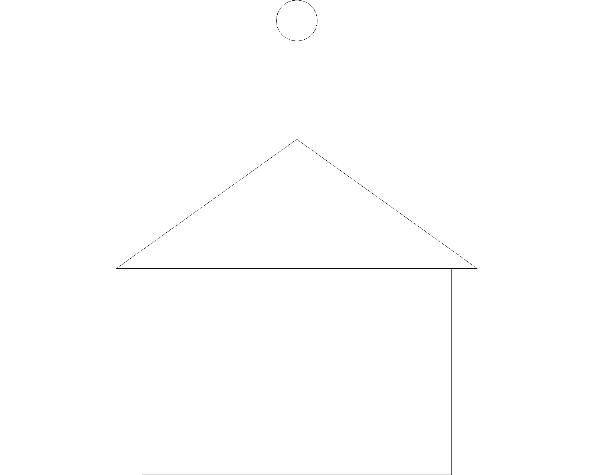

# v0.4 development iteration: actual reliability and feedback evidence

Date: 2026-11-20, Asia/Shanghai. Work item [#19](https://github.com/codesknight/Cader/issues/19), v0.4 milestone. Development snapshot: 0.4.0-dev.1, not full v0.4 acceptance. Source: user v0.3 failure transcript and v0.4 guide. The guide's proposed commands/gates were evaluated against code rather than treated as implemented capabilities or automatic cross-repository write authorization.

## Confirmed call chain and ownership

CLI InteractiveSession → runTask → existing DSH/Cordis AgentLoop → role-scoped wrapped MCP schema → ExecutionSession serial queue → DSH MCP stdio client → AutoCAD-MCP COMBackend serial STA queue → COMSession → CADConnection/controller/query. Only the main agent owns dynamic CAD/file/Shell tools. No replacement AgentLoop or new agent platform was introduced.

Cader base: 8de4ef2 (7709770 implementation plus already-local acceptance docs). MCP checkout: 2fa9948, independent conda environment. Its three web/backend files and several untracked research/image assets contain user work; they were not changed. Cader's user-provided untracked docs/designs/Cader_v0.4.0_Development_Guide.md was preserved and is not included automatically in the implementation commit.

The original Drawing8 barrier remains intact. Tests create separate workspaces under .cader/runs and new AutoCAD scratch documents. No old unknown request was replayed, no user drawing was closed, saved, overwritten or adopted for writes.

## Historical trigger versus newly reproduced failures

The original 01:33:48 draw_line failure cannot be conclusively reconstructed because v0.3 discarded the protocol error and combined mutation/readback/artifact/audit exceptions. That is a confirmed observability defect, not proof that the original operation failed in COM.

New real-CAD reproduction captured two distinct native failures:

1. Run reliability-cee37711-a329-4890-b50c-d3af9067ba62: independent MCP A=3x100 lines all passed; owner B round 1=100 passed (279159ms). The next new_drawing failed during dispatch with the original MCP text `Error executing tool new_drawing: <unknown>.Name`. The backend creates a document and reads Name outside its readiness loop; this exposes a plausible post-creation readiness failure with possible side effects. It does not prove the historical draw_line failure had the same cause. Barrier retained.
2. Run reliability-9d15c2bb-6537-4ee8-b91d-90d28ccb81e2: A=3x100 passed; optimized B round 1=100 passed (18991ms). The next new_drawing was acknowledged, then postflight query_entities failed with HRESULT -2147418111 / RPC_E_CALL_REJECTED (callee rejected call). It was correctly classified committed_observation_failed, not an unknown new-document mutation. The suite stopped; remaining B rounds and E lifecycle gates are not accepted.

No arbitrary sleeps or backend swap were used to conceal either failure. The one-round comparison illustrates the cost of querying every entity after every write: affected-ObjectID readback reduced this isolated round from 279159ms to 18991ms. This is not a multi-round performance guarantee. Each completed round independently compared every actual line endpoint and exact entity count with the expected coordinates.

## Implemented execution semantics

Preflight/dispatch/acknowledgement/postflight/artifact verification are separate. Private JSONL preserves original MCP failure content, available HRESULT, stack and operation/model-call correlation. Model step dispatch events provide a joinable batch ID; native worker IDs, wire-level MCP request IDs and authoritative COM revisions remain unavailable.

An unknown dispatched mutation freezes further writes. Queued siblings are blocked_not_dispatched and never reach MCP. Frozen write tools are removed from later model steps. Only an acknowledged mutation followed by failed postflight on the original still-owned connection can recover by repeating the read; mutation replay is never used. Lost responses, legacy locks, reconnects and capture uncertainty remain frozen. Native empty documents/not_probed status is treated as unavailable metadata. /mcp doctor and /mcp recover, plus model health/recover tools, expose these distinctions.

Generic reports force ok=false/task_status=blocked when authoritative execution state is frozen even if the model's run_status=succeeded. Operation evidence and terminal counts come from the ledger; they do not assert entity counts or semantic correctness. Invalid finite/XYZ/radius/zero-length constraints fail before dispatch without freezing. Targeted entity observations are explicitly distinguished from full-document queries.

## Fault evidence and image path

Real CAD client-boundary fault injection run faults-daedbb57-b2e1-46e2-8cc6-4fd2f0867121 passed 11/11 checks: acknowledged write/readback failure recovery without replay; actual committed line with intentionally suppressed response remains unknown and blocks follow-up/recovery; cancellation waits for the owned operation and preserves one actual committed entity. These are explicit injected adapter failures around real CAD operations, not native COM crashes, real packet-loss tests or deterministic mock CAD results.

The actual DSH offline attachment test confirms the new main-agent view tool forwards an image attachment to the configured vision worker, retains image request evidence, validates structured reviews and enforces a bounded review budget. This is fixture evidence, not a real-model vision pass.

Real Pro model run visual-ff20e68d-a2aa-453d-8881-87f026e3e173 autonomously created the specified wall, roof and intentionally floating circular window. export_current_view timed out; the model correctly reported frozen state and did not send new mutation probes. No vision worker/image request was executed, no correction passed. A PNG materialized approximately one second after the error, showing the intended defect. This is consistent with delayed asynchronous plotting/COM message processing, but the cause is not confirmed without a backend experiment. The late image was inspected; it is not relabeled as a successful vision result. Backend export changes viewport/plot state, so its uncertainty is conservatively protected.



## Reproduction and outstanding gates

```powershell
pnpm live-smoke --mcp configs/mcp/AutoCAD.local.yaml --reliability
pnpm live-smoke --mcp configs/mcp/AutoCAD.local.yaml --faults
pnpm live-smoke --mcp configs/mcp/AutoCAD.local.yaml --visual
```

Commands are explicit real-CAD opt-in; visual also calls paid models. Unknown scenario barriers are retained in isolated workspaces. Do not delete a barrier and rerun the original operation.

A concrete MCP Name-readiness/point-arity patch was prepared and approval requested under AGENTS.md's adjacent-project rule; it has not been applied. Native quiescence/health, full export setting restoration and message-pump behavior need backend work. Original first-failure cause, complete 3x100 owner/lifecycle acceptance, native timeout/crash injection, successful real visual correction, batch approval and electrical topology acceptance remain open. No full v0.4 release, arbitrary-DWG editing, controlled COM reopen or full upstream DSH app-profile acceptance is claimed.


Source checkpoints for this snapshot: Cader packages/profile/src/execution.ts:23 (owner), :63 (capture), :124 (recovery), :216–223 (dispatch/ack/postflight); packages/dsh-adapter/src/live.ts:317 (public error classification). Read-only MCP audit: src/autocad_mcp/cad/connection.py:62/77 (readiness/new document), cad/backends/com_backend.py:83 (lifecycle-only status), cad/controller.py:226 (asynchronous file wait). Line numbers identify the inspected snapshot; future commits may move them.

Local pinned-Node checks: typecheck passed, 53/53 tests passed, Harness smoke 6/6 passed. Early failures (new tool expectation and compiled test import path) were corrected and retained in testing.md. Cross-platform CI follows the implementation commit; real-CAD failures above remain failures regardless of CI status.

## Remote publication and offline CI

Development branch `codex/v0.4-reliable-execution` is published, including implementation commits 880baf1/cf1dbc1 and documentation submission 55ad82f. [CI run 44667978153](https://github.com/codesknight/Cader/actions/runs/44667978153) passed all four Windows/Linux DSH/Python jobs. This resolves the earlier Git push limitation, not the real-CAD failures recorded above. No paid-model/real-CAD checks were rerun during this documentation submission; #19 and the v0.4 milestone remain open.
